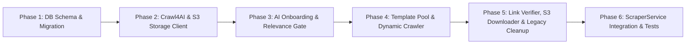

# Autonomous Crawl4AI Multi-Level Scraping & Raw Extraction Pipeline

## 1. Executive Summary & Architectural Decisions

This specification defines the redesigned, fully autonomous **Data Extraction Engine** (Producer) for Afaq-AI-Service. It replaces all hardcoded legacy adapters with a unified, browser-driven crawling engine powered by `crawl4ai` and self-healing multi-template libraries.

### Key Architectural Decisions:
1. **Zero-Configuration Source Onboarding:**
   Administrators only provide the entry-point URL in the `sources` table. An AI discovery pass autonomously inspects the website, identifies its name and metadata, detects supported languages, configures pagination, and populates a dedicated `source_configs` table.
2. **Strict Separation of Concerns:**
   * `sources`: Minimal, administrative registry of target URLs.
   * `source_configs`: Highly detailed, AI-discovered technical parameters (pagination rules, timeouts, selectors, health metrics).
   * `scraping_templates`: Dynamic template library retaining historical and recurring page layouts per source.
3. **Multi-Template Library & Layout Rotation:**
   Platforms often cycle through 2 to 4 recurring layouts (e.g., standard vs. sponsored articles, list vs. grid views). Rather than discarding old templates or invoking LLMs repeatedly, the engine maintains all historical templates in a pool, attempting fast deterministic matches before calling AI.
4. **Complete Phase-Out of Legacy Adapters:**
   All legacy hardcoded Python scrapers (`Almin7Adapter`, `GrabScholarshipAdapter`, `Scholars4DevAdapter`, `WordPressApiAdapter`, and `AdapterFactory`) are completely eliminated.
5. **Decoupled Scheduling:**
   Crawl frequency/scheduling is removed from the scraping tables and delegated to a dedicated scheduling subsystem.
6. **AWS S3 Document Storage:**
   All downloadable application forms, PDFs, and guides are streamed directly into an AWS S3 bucket with SHA256 deduplication.
7. **Pre-AI Validation & Content Relevance Gates:**
   Access failures (Cloudflare blocks, parking domains, HTTP 403/404) are intercepted before invoking AI. During template synthesis, the prompt instructs the LLM to inspect domain relevance first; non-opportunity pages trigger explicit, pre-defined error codes to eliminate wasted LLM costs.

---

## 2. Database Schema Design (Extraction Layer)

The data model is partitioned into six focused tables, cleanly separating administrative inputs, technical configurations, template libraries, operational telemetry, and raw two-level extractions.

### 2.1. `sources` (Administrative URL Registry)
Minimal, clean interface for administrators to register targets:
* `id: UUID (PK)`
* `url: String` — Target website entry URL (e.g., `https://almin7.com/scholarships/`).
* `name: String?` — Optional label; auto-generated by AI if omitted.
* `is_active: Boolean` — Default `true`. Admin kill-switch.
* `created_by: String?` — Admin user identifier.
* `created_at: DateTime`
* `updated_at: DateTime`

### 2.2. `source_configs` (Technical Crawling & Discovery Settings)
Populated and maintained autonomously by the engine:
* `id: UUID (PK)`
* `source_id: UUID (FK, Unique)` — References `sources.id` (1-to-1).
* `domain: String` — Normalized domain for indexing (`almin7.com`).
* `site_name: String` — AI-discovered official website name.
* `site_description: String?` — AI-generated summary of the portal.
* `supported_languages: String[]` — Discovered languages (e.g. `["ar"]`, `["ar", "en"]`).
* `language_switch_type: String?` — `hreflang`, `url_prefix`, `cookie`, `none`.
* `pagination_type: String` — `next_button`, `url_param`, `infinite_scroll`, `none`.
* `pagination_config: Json` — Specific rules (e.g., parameter name, base selector, page limit).
* `wait_for_selector: String?` — Specific DOM element Crawl4AI waits for before parsing.
* `page_timeout_sec: Int` — Max navigation timeout (default: 30s).
* `max_pages_per_run: Int` — Max listing pages to traverse per job (default: 10).
* `drift_detected: Boolean` — Default `false`. Flagged when extraction yields collapse.
* `consecutive_failures: Int` — Counter triggering administrative alerts.
* `last_scraped_at: DateTime?`
* `created_at: DateTime`
* `updated_at: DateTime`

### 2.3. `scraping_templates` (Multi-Template Pool & History)
Stores multiple extraction schemas per source to handle layout rotation without LLM calls:
* `id: UUID (PK)`
* `source_id: UUID (FK)` — References `sources.id`.
* `level: Int` — `1` (Listing Catalog) or `2` (Detail Page).
* `layout_signature: String` — Hash or fingerprint representing the DOM structure.
* `schema_type: String` — `CSS` or `XPATH`.
* `template_schema: Json` — Declarative JSON schema compatible with `JsonCssExtractionStrategy`.
* `version: Int` — Incremental template version.
* `is_active: Boolean` — Default `true`. Included in the matching candidate pool.
* `hit_count: Int` — Number of times this template was successfully applied.
* `last_successful_use_at: DateTime?`
* `created_at: DateTime`
* `updated_at: DateTime`
* `CONSTRAINT unique_source_level_version UNIQUE (source_id, level, version)`

### 2.4. `scrape_operations` (Job Telemetry & Reports)
Audit logs and operational reports for each scrape execution:
* `id: UUID (PK)` — The `operation_id` generated per execution.
* `status: String` — `running`, `completed`, `failed`, `partial`.
* `triggered_by: String` — `cron`, `admin_api`, `manual_retry`.
* `sources_attempted: String[]`
* `sources_succeeded: String[]`
* `sources_failed: String[]`
* `total_listings_found: Int` — Discovered Level 1 cards.
* `total_details_extracted: Int` — Parsed Level 2 opportunities.
* `total_files_downloaded: Int` — S3 document attachments saved.
* `error_summary: Json` — Failure reasons and error codes per source.
* `started_at: DateTime`
* `completed_at: DateTime?`

### 2.5. `raw_listings` (Level 1 Catalog Extraction)
Records discovered scholarship cards from catalog pages:
* `id: UUID (PK)`
* `operation_id: UUID (FK)` — References `scrape_operations.id`.
* `source_id: UUID (FK)` — References `sources.id`.
* `discovered_url: String` — Direct link to the opportunity detail page.
* `card_title_preview: String?` — Title snippet from the catalog card.
* `card_snippet_preview: String?`
* `listing_page_url: String` — Paginated URL where this card was discovered.
* `status: String` — `pending_detail_crawl`, `details_extracted`, `failed`.
* `scraped_at: DateTime`
* `created_at: DateTime`
* `CONSTRAINT unique_source_discovered_url UNIQUE (source_id, discovered_url)`

### 2.6. `raw_grant_details` (Level 2 Comprehensive Extraction)
Stores complete, uncleaned scholarship data and verification results:
* `id: UUID (PK)`
* `listing_id: UUID? (FK)` — References parent `raw_listings.id`.
* `operation_id: UUID (FK)` — References `scrape_operations.id`.
* `source_id: UUID (FK)` — References `sources.id`.
* `template_id: UUID? (FK)` — References `scraping_templates.id` used for extraction.
* `source_url: String` — Scholarship detail URL.
* `raw_payload: Json` — Structured raw extraction (title, university, funding, eligibility, deadline).
* `detected_language: String` — `ar` or `en`.
* `link_verification_status: String` — `verified`, `suspicious`, `unreachable`, `s3_download`.
* `final_application_url: String?` — Resolved destination URL after redirects.
* `is_legitimate_domain: Boolean?`
* `has_attachment: Boolean` — Default `false`.
* `attachment_s3_key: String?` — S3 object key (`s3://afaq-attachments/...`).
* `attachment_metadata: Json?` — File size, mime-type, SHA256 checksum.
* `status: String` — `pending` (ready for downstream cleaning), `processing`, `cleaned`, `failed`.
* `error_message: String?`
* `scraped_at: DateTime`
* `created_at: DateTime`

---

## 3. Seven-Stage Pipeline Architecture

```
[ Admin: Adds Source URL ]
           │
           ▼
[ Stage 0: Zero-Config Onboarding & Relevance Gate ]
  (Pre-AI Check ➔ Crawl ➔ AI Site Inspection ➔ Store Config & Languages)
           │
           ▼
[ Stage 1: Batch Operation Initialization ]
  (POST /api/v1/scrape/run ➔ operation_id ➔ 202 Accepted ➔ Background Task)
           │
           ▼
[ Stage 2: Crawl4AI Core Crawling & Anti-Bot Defense ]
  (Headless Chromium + Stealth ➔ Target Domain Verification ➔ Politeness Delays)
           │
           ▼
[ Stage 3: Multi-Template Pool Matching (Zero LLM Cost) ]
  (Evaluate DOM against historical template pool ➔ Match Found? ➔ Use Immediately)
           │
      No Match Found
           ▼
[ Stage 4: Autonomous AI Schema Synthesis & Content Gate ]
  (Domain Relevance Gate ➔ agenerate_schema ➔ Dry-Run Test ➔ Add to Template Pool)
           │
           ▼
[ Stage 5: Dynamic Pagination & Level 1 Traversal ]
  (URL params / Next buttons ➔ Discovered URLs saved to raw_listings)
           │
           ▼
[ Stage 6: Level 2 Detail Crawl, S3 Document Download & Anti-Fraud ]
  (Extract Details ➔ Verify Link / Follow Redirects ➔ Stream PDFs to AWS S3)
           │
           ▼
[ Stage 7: Downstream Handoff & Operation Telemetry ]
  (Save raw_grant_details with status="pending" ➔ Finalize scrape_operations ➔ Webhook)
```

---

### Stage 0: Zero-Configuration Onboarding & Relevance Gate
When an administrator registers a new URL in `sources`:
1. **Pre-AI Target Verification:**
   * Perform an HTTP head/connectivity check to ensure the domain is active.
   * Intercept parking domains, DNS errors, or HTTP 403/404/500 screens before invoking AI.
2. **Initial Crawl via Crawl4AI:**
   * Crawl the entry page in headless stealth mode to fetch `cleaned_html`.
3. **AI Content Inspection & Relevance Gate:**
   * The initial analysis prompt instructs the LLM:
     > *"Verify whether this page represents an authentic educational opportunity, scholarship, or academic portal. If the site is irrelevant, an ad-farm, or a dead domain, return `{ 'error': 'ERR_IRRELEVANT_CONTENT_REJECTED' }`."*
   * If rejected, the source is marked `is_active = false` with an administrative alert, avoiding further compute or LLM expense.
4. **Autonomous Configuration Extraction:**
   * If valid, the AI analyzes the HTML to identify:
     * Site name and description.
     * Supported languages (detecting language toggle links, `hreflang` tags, or route prefixes like `/ar/` or `/en/`).
     * Pagination structure (URL query pattern, CSS next button, or infinite scroll).
     * Optimal DOM wait selector and timeouts.
   * Automatically populates `source_configs`.

---

### Stage 1: Batch Operation Initialization
1. Initiated via `POST /api/v1/scrape/run` (with optional `source_ids: list[str]`).
2. Generates a distinct `operation_id = uuid4()`.
3. Queries eligible sources: `WHERE is_active = true`.
4. Creates an entry in `scrape_operations` with `status = "running"`.
5. Returns `HTTP 202 Accepted` immediately with operation metadata.
6. Enqueues the asynchronous orchestrator in FastAPI `BackgroundTasks`.

---

### Stage 2: Crawl4AI Core Crawling & Anti-Bot Defense
1. **Browser Execution:**
   * Managed via `crawl4ai.AsyncWebCrawler` using headless Chromium.
   * Stealth parameters enabled to bypass Cloudflare and standard bot challenges.
2. **Politeness & Rate-Limiting:**
   * Implements random jitter delays (2.0s to 4.5s) between consecutive requests to the same domain.
   * Rotates standard modern desktop User-Agents.
3. **Target Domain Verification:**
   * Confirms the retrieved page URL matches the target domain (detecting unwanted redirects to parking domains or captive portals).

---

### Stage 3: Multi-Template Pool Matching (Zero LLM Cost)
When processing Level 1 (listing) or Level 2 (detail) HTML:
1. The engine retrieves **all active templates** for this source from `scraping_templates` ordered by `hit_count DESC`.
2. **Fast Evaluation Gate:**
   * Iterates through candidate templates without invoking AI.
   * Runs `JsonCssExtractionStrategy(schema=template_schema)` on the current HTML.
   * Verifies critical fields:
     * Level 1: `base_selector` yields $\ge 1$ item, and items contain a valid URL.
     * Level 2: Mandatory fields (`title` and `application_url` / `source_url`) are present.
3. **Outcome:**
   * **Match Found:** Increments `hit_count`, updates `last_successful_use_at`, and immediately proceeds with the extracted data. This handles platforms alternating across 2–4 layouts with zero LLM overhead.
   * **All Fail:** Proceeds to Stage 4.

---

### Stage 4: Autonomous AI Schema Synthesis & Content Gate
Triggered only when no existing template in the pool matches the current layout:
1. **AI Content Re-Validation Gate:**
   * The synthesis prompt enforces a strict verification check:
     > *"Before generating extraction selectors, verify that this page contains scholarship/opportunity information. If the content represents an error page, expired listing, or unrelated text, return: `{'error': 'ERR_NOT_OPPORTUNITY_PORTAL'}`."*
   * If an error code is returned, synthesis aborts cleanly, and the incident is logged in `scrape_operations.error_summary`.
2. **Schema Generation via Crawl4AI:**
   * Executes `JsonCssExtractionStrategy.agenerate_schema` using Gemini Flash via `LLMConfig`.
   * Targets canonical JSON contracts (Level 1: cards, pagination; Level 2: full scholarship attributes).
3. **Dry-Run Validation Gate:**
   * Runs the candidate schema against the retrieved HTML sample.
   * Must pass the strict validation gate (valid container, non-empty title, valid action link).
4. **Template Library Update:**
   * Stores the validated schema as a new version in `scraping_templates`.
   * Resets `source_configs.drift_detected = false`.
   * The new template is now part of the source's permanent layout pool.

---

### Stage 5: Dynamic Pagination & Full Catalog Traversal
1. Reads `pagination_type` and `pagination_config` from `source_configs`:
   * **URL Parameter Pagination:** Iterates `?page=N` or `?paged=N` until zero new items or `max_pages_per_run` is reached.
   * **Next Button Selector:** Crawl4AI follows `.pagination .next a[href]` until absent.
   * **Varying Page Sizes:** Handles platforms with configurable page sizes (e.g. `?limit=50`).
2. Discovered links are upserted into `raw_listings`:
   ```sql
   INSERT INTO raw_listings (operation_id, source_id, discovered_url, card_title_preview, listing_page_url, status)
   VALUES (...)
   ON CONFLICT (source_id, discovered_url) DO NOTHING;
   ```
3. Guarantees idempotency—existing scholarships are not re-queued unnecessarily.

---

### Stage 6: Detail Crawl, S3 Document Download & Anti-Fraud
For each newly discovered `raw_listing`:
1. Navigates to the scholarship detail URL via Crawl4AI.
2. Extracts comprehensive fields using the active/matched Level 2 template.
3. **Application Link Verification (Anti-Fraud Gate):**
   * Performs an asynchronous `HEAD`/`GET` request following HTTP redirects.
   * Resolves the `final_application_url`.
   * Flags suspicious patterns (ad-shorteners, spam redirects, unencrypted HTTP submission portals).
4. **AWS S3 Document / PDF Stream Downloader:**
   * If the target application link points to a file (`Content-Type: application/pdf`, `.docx`, etc.):
     1. Streams the file contents directly to AWS S3:
        `s3://{BUCKET_NAME}/attachments/{source_id}/{sha256_hash}.pdf`
     2. Sets `has_attachment = true`.
     3. Saves S3 key, file size, mime-type, and SHA256 checksum in `attachment_metadata`.
5. **Language Determination:**
   * Evaluates text using Unicode character analysis:
     * Arabic range: `[\u0600-\u06FF]`.
     * If Arabic characters $> 30\%$, sets `detected_language = "ar"`; otherwise `"en"`.

---

### Stage 7: Downstream Handoff & Operation Telemetry
1. Inserts the extracted record into `raw_grant_details` with `status = "pending"`.
2. Updates `raw_listings.status = "details_extracted"`.
3. **Batch Wrap-Up:**
   * Once all sources complete, updates `scrape_operations`:
     * `status = "completed"` (or `"partial"` if any source failed).
     * Compiles `total_listings_found`, `total_details_extracted`, `total_files_downloaded`.
     * Writes `error_summary`.
   * Dispatches the completion webhook payload to the primary backend.

---

## 4. Phasing Out the Legacy Scraping System

All legacy adapters and static files are scheduled for complete deletion:

| Legacy Component to Remove | Replacement in New Architecture |
| :--- | :--- |
| `src/modules/scraping/adapters/almin7_adapter.py` | Unified `Crawl4AiCrawler` + Dynamic Level 1/2 Templates |
| `src/modules/scraping/adapters/grabscholarship_adapter.py` | Unified `Crawl4AiCrawler` + Dynamic Level 1/2 Templates |
| `src/modules/scraping/adapters/scholars4dev_adapter.py` | Unified `Crawl4AiCrawler` + Dynamic Level 1/2 Templates |
| `src/modules/scraping/adapters/wordpress_api_adapter.py` | Unified `Crawl4AiCrawler` + Dynamic Level 1/2 Templates |
| `src/modules/scraping/adapters/adapter_factory.py` | `TemplateEngine` matching against `scraping_templates` |
| `src/modules/scraping/adapters/base_adapter.py` | Replaced by `CrawlerProtocol` and `TemplateEngineProtocol` |

---

## 5. Pre-Defined AI Error Codes & Guardrails

To prevent LLM billing waste on invalid content, the AI prompts enforce the following strict error code contract:

| Error Code | Trigger Condition | System Action |
| :--- | :--- | :--- |
| `ERR_IRRELEVANT_CONTENT_REJECTED` | Site is a blog, commercial store, or unrelated content | Deactivates source; sends admin alert |
| `ERR_NOT_OPPORTUNITY_PORTAL` | Page is a dead link, 404, or generic home screen | Increments `consecutive_failures`; skips page |
| `ERR_ACCESS_CHALLENGE_BLOCKED` | Cloudflare / CAPTCHA challenge captured in DOM | Flags proxy/stealth failure; triggers cool-down |
| `ERR_PARKING_OR_EXPIRED_DOMAIN` | Domain expired, domain-for-sale, or registrar splash | Deactivates source permanently |
| `ERR_SCHEMA_VALIDATION_FAILED` | Generated selectors failed dry-run against HTML sample | Retries generation once with negative feedback |

---

## 6. Phased Implementation Roadmap



* **Phase 1: Database Architecture & Prisma Migration:**
  Create tables: `sources` (clean), `source_configs`, `scraping_templates`, `scrape_operations`, `raw_listings`, `raw_grant_details`.
* **Phase 2: Crawl4AI Driver & S3 Storage Client:**
  Configure `Crawl4AiCrawler` with stealth and user-agent rotation; build `S3StorageClient` for streaming uploads.
* **Phase 3: AI Onboarding Engine & Content Guard:**
  Implement Stage 0 discovery worker with strict content rejection error codes.
* **Phase 4: Multi-Template Library & Dynamic Crawler:**
  Implement template pool matching, schema synthesis fallback, and dynamic pagination handling.
* **Phase 5: Link Verification, S3 Downloader & Legacy Cleanup:**
  Implement anti-fraud link checker and PDF stream downloader; delete all legacy adapter files.
* **Phase 6: Orchestration, Webhooks & Test Suite:**
  Connect `ScraperService` to the new pipeline, emit webhook telemetry, and author deterministic unit tests following `AGENT.md`.
