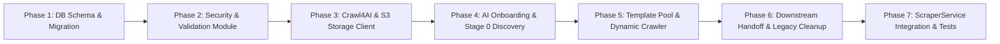

# Autonomous Crawl4AI Multi-Level Scraping & Raw Extraction Pipeline

## 1. Executive Summary & Architectural Decisions

This specification defines the redesigned, fully autonomous **Data Extraction Engine** (Producer) for Afaq-AI-Service. It replaces all hardcoded legacy adapters with a unified, browser-driven crawling engine powered by `crawl4ai` and self-healing multi-template libraries.

### Key Architectural Decisions:
1. **Zero-Configuration Source Onboarding:**
   Administrators only provide the entry-point URL in the `sources` table. An AI discovery pass autonomously inspects the website, identifies its name and metadata, detects supported languages, configures pagination, and populates a dedicated `source_configs` table.
2. **Strict Separation of Concerns:**
   * `sources`: Minimal, administrative registry of target URLs.
   * `source_configs`: Highly detailed, AI-discovered technical parameters (pagination rules, timeouts, selectors, health metrics).
   * `scraping_templates`: Dynamic template library retaining historical and recurring page layouts per source.
3. **Multi-Template Library & Layout Rotation:**
   Platforms often cycle through 2 to 4 recurring layouts (e.g., standard vs. sponsored articles, list vs. grid views). Rather than discarding old templates or invoking LLMs repeatedly, the engine maintains all historical templates in a pool, attempting fast deterministic matches before calling AI.
4. **Complete Phase-Out of Legacy Adapters:**
   All legacy hardcoded Python scrapers (`Almin7Adapter`, `GrabScholarshipAdapter`, `Scholars4DevAdapter`, `WordPressApiAdapter`, and `AdapterFactory`) are completely eliminated.
5. **Decoupled Scheduling:**
   Crawl frequency/scheduling is removed from the scraping tables and delegated to a dedicated scheduling subsystem.
6. **AWS S3 Document Storage:**
   All downloadable application forms, PDFs, and guides are streamed directly into an AWS S3 bucket with SHA256 deduplication.
7. **Pre-AI Validation & Content Relevance Gates:**
   Access failures (Cloudflare blocks, parking domains, HTTP 403/404) are intercepted before invoking AI. During template synthesis, the prompt instructs the LLM to inspect domain relevance first; non-opportunity pages trigger explicit, pre-defined error codes to eliminate wasted LLM costs.
8. **Mandatory Security, Link Validation & Content Sanitization Gateway:**
   All network requests, URLs, and incoming web content must traverse the centralized `src/modules/security/` module (`LinkValidator`, `ContentSanitizer`, and `FileValidator`). Enforces strict Anti-SSRF private IP blocking, 5-hop circular redirect traps, pure plain-text extraction for structured fields, Rust-based `nh3` safe HTML sanitization, LLM prompt injection shielding, and pre-S3 magic-byte validation.

---

## 2. Database Schema Design (Extraction Layer)

The data model is partitioned into six focused tables, cleanly separating administrative inputs, technical configurations, template libraries, operational telemetry, and raw two-level extractions.

### 2.1. `sources` (Administrative URL Registry)
Minimal, clean interface for administrators to register targets:
* `id: UUID (PK)`
* `url: String` — Target website entry URL (e.g., `https://almin7.com/scholarships/`).
* `name: String?` — Optional label; auto-generated by AI if omitted.
* `is_active: Boolean` — Default `true`. Admin kill-switch.
* `created_by: String?` — Admin user identifier.
* `created_at: DateTime`
* `updated_at: DateTime`

### 2.2. `source_configs` (Technical Crawling & Discovery Settings)
Populated and maintained autonomously by the engine:
* `id: UUID (PK)`
* `source_id: UUID (FK, Unique)` — References `sources.id` (1-to-1).
* `domain: String` — Normalized domain for indexing (`almin7.com`).
* `site_name: String` — AI-discovered official website name.
* `site_description: String?` — AI-generated summary of the portal.
* `supported_languages: String[]` — Discovered languages (e.g. `["ar"]`, `["ar", "en"]`).
* `language_switch_type: String?` — `hreflang`, `url_prefix`, `cookie`, `none`.
* `pagination_type: String` — `next_button`, `url_param`, `infinite_scroll`, `none`.
* `pagination_config: Json` — Specific rules (e.g., parameter name, base selector, page limit).
* `wait_for_selector: String?` — Specific DOM element Crawl4AI waits for before parsing.
* `page_timeout_sec: Int` — Max navigation timeout per page (default: 30s).
* `max_operation_timeout_sec: Int` — Max execution ceiling for entire scrape operation per source (default: 1200s / 20 min).
* `max_pages_per_run: Int` — Max listing pages to traverse per job (default: 10).
* `max_concurrent_crawls: Int` — Max concurrent browser tabs (default: `1` for strictly bounded single-process memory footprint; configurable for future horizontal scaling).
* `rate_limit_delay_sec: Float` — Default `1.0`. Inter-request delay (populated from `robots.txt` `Crawl-delay` if present).
* `cool_down_until: DateTime?` — Timestamp populated when HTTP 429 (`Retry-After`) is received; skips crawling until expiration.
* `robots_txt_sitemaps: String[]` — Discovered XML sitemap URLs extracted from `robots.txt` during Stage 0.
* `is_locked: Boolean` — Default `false`. Distributed lock preventing duplicate concurrent runs on the same source.
* `locked_at: DateTime?` — Lock timestamp (auto-expires after 30 minutes to prevent deadlocks).
* `has_multi_tab_details: Boolean` — Default `false`. Discovered in Stage 0 if detail pages use tabs.
* `tab_container_selector: String?` — Discovered selector for tab headers (e.g. `.nav-tabs a`).
* `has_multi_page_details: Boolean` — Default `false`. Discovered if detail articles span sub-pages.
* `subpage_pagination_selector: String?` — Discovered selector for in-article subpage pagination.
* `drift_detected: Boolean` — Default `false`. Flagged when extraction yields collapse.
* `consecutive_failures: Int` — Counter triggering administrative alerts.
* `last_scraped_at: DateTime?`
* `created_at: DateTime`
* `updated_at: DateTime`

### 2.3. `scraping_templates` (Multi-Template Pool & History)
Stores multiple extraction schemas per source to handle layout rotation without LLM calls:
* `id: UUID (PK)`
* `source_id: UUID (FK)` — References `sources.id`.
* `level: Int` — `1` (Listing Catalog) or `2` (Detail Page).
* `layout_signature: String` — Hash or fingerprint representing the DOM structure.
* `schema_type: String` — `CSS` or `XPATH`.
* `template_schema: Json` — Declarative JSON schema compatible with `JsonCssExtractionStrategy`.
* `version: Int` — Incremental template version.
* `is_active: Boolean` — Default `true`. Included in the matching candidate pool.
* `hit_count: Int` — Number of times this template was successfully applied.
* `last_successful_use_at: DateTime?`
* `created_at: DateTime`
* `updated_at: DateTime`
* `CONSTRAINT unique_source_level_version UNIQUE (source_id, level, version)`

### 2.4. `scrape_operations` (Job Telemetry & Reports)
Audit logs and operational reports for each scrape execution:
* `id: UUID (PK)` — The `operation_id` generated per execution.
* `idempotency_key: String? (Unique)` — Optional UUID from `Idempotency-Key` header to safely deduplicate retried trigger requests.
* `status: String` — `running`, `completed`, `failed`, `partial`, `timed_out`.
* `triggered_by: String` — `cron`, `admin_api`, `manual_retry`.
* `sources_attempted: String[]`
* `sources_succeeded: String[]`
* `sources_failed: String[]`
* `total_listings_found: Int` — Discovered Level 1 cards.
* `total_details_extracted: Int` — Parsed Level 2 opportunities.
* `total_files_downloaded: Int` — S3 document attachments saved.
* `error_summary: Json` — Failure reasons and error codes per source.
* `started_at: DateTime`
* `completed_at: DateTime?`

### 2.5. `raw_listings` (Level 1 Catalog Extraction & Multi-Page Tree)
Records discovered scholarship cards from catalog pages and tracks multi-page article lineage:
* `id: UUID (PK)`
* `operation_id: UUID (FK)` — References `scrape_operations.id`.
* `source_id: UUID (FK)` — References `sources.id`.
* `parent_id: UUID? (Self-FK)` — References parent listing ID for multi-page articles (Tree lineage).
* `root_listing_id: UUID?` — Root page ID of the multi-page article tree for rapid indexing.
* `page_number: Int` — Default `1`. Sequential page number in a multi-page article hierarchy.
* `tree_depth: Int` — Default `0`. Hierarchical depth in the multi-page tree.
* `discovered_url: String` — Direct link to the opportunity detail page.
* `card_title_preview: String?` — Title snippet from the catalog card.
* `card_snippet_preview: String?`
* `card_image_url: String?` — Discovered card thumbnail image URL.
* `listing_page_url: String` — Paginated URL where this card was discovered.
* `status: String` — `pending_detail_crawl`, `details_extracted`, `failed`, `failed_permanently`.
* `retry_count: Int` — Default `0`. Number of failed extraction attempts.
* `max_retries: Int` — Default `3`. Threshold before routing to `failed_permanently` (Database DLQ).
* `extraction_errors: Json?` — Audit logs of extraction failures and stack traces.
* `scraped_at: DateTime`
* `created_at: DateTime`
* `CONSTRAINT unique_source_discovered_url UNIQUE (source_id, discovered_url)`

### 2.6. `raw_grant_details` (Level 2 Comprehensive Extraction)
Stores complete, uncleaned scholarship data and verification results:
* `id: UUID (PK)`
* `listing_id: UUID? (FK)` — References parent `raw_listings.id`.
* `opportunity_group_id: UUID?` — Shared UUID linking corresponding Arabic and English versions of the same opportunity.
* `operation_id: UUID (FK)` — References `scrape_operations.id`.
* `source_id: UUID (FK)` — References `sources.id`.
* `template_id: UUID? (FK)` — References `scraping_templates.id` used for extraction.
* `source_url: String` — Scholarship detail URL.
* `template_version: Int` — Version number of the template used for extraction (e.g. 1.0, 1.1).
* `raw_payload: Json` — Structured raw extraction (title, university, funding, eligibility, deadline).
* `image_url: String?` — Featured / hero scholarship image URL.
* `detected_language: String` — `ar` or `en`.
* `link_verification_status: String` — `verified`, `suspicious`, `unreachable`, `s3_download`.
* `final_application_url: String?` — Resolved destination URL after redirects.
* `is_legitimate_domain: Boolean?`
* `has_attachment: Boolean` — Default `false`.
* `attachment_s3_key: String?` — S3 object key (`s3://afaq-attachments/...`).
* `attachment_metadata: Json?` — File size, mime-type, SHA256 checksum.
* `status: String` — `pending` (ready for downstream cleaning), `processing`, `cleaned`, `failed`, `failed_permanently`.
* `retry_count: Int` — Default `0`.
* `max_retries: Int` — Default `3`. Threshold before dead-lettering to `failed_permanently`.
* `extraction_errors: Json?` — Detailed error history.
* `error_message: String?`
* `scraped_at: DateTime`
* `created_at: DateTime`

---

## 3. Seven-Stage Pipeline Architecture

```
[ Admin: Adds Source URL ]
           │
           ▼
[ Stage 0: Zero-Config Onboarding & Relevance Gate ]
  (Pre-AI Check ➔ Crawl ➔ AI Site Inspection ➔ Store Config & Languages)
           │
           ▼
[ Stage 1: Batch Operation Initialization ]
  (POST /api/v1/scrape/run ➔ operation_id ➔ 202 Accepted ➔ Background Task)
           │
           ▼
[ Stage 2: Crawl4AI Core Crawling & Anti-Bot Defense ]
  (Headless Chromium + Stealth ➔ Target Domain Verification ➔ Politeness Delays)
           │
           ▼
[ Stage 3: Multi-Template Pool Matching (Zero LLM Cost) ]
  (Evaluate DOM against historical template pool ➔ Match Found? ➔ Use Immediately)
           │
      No Match Found
           ▼
[ Stage 4: Autonomous AI Schema Synthesis & Content Gate ]
  (Domain Relevance Gate ➔ agenerate_schema ➔ Dry-Run Test ➔ Add to Template Pool)
           │
           ▼
[ Stage 5: Dynamic Pagination & Level 1 Traversal ]
  (URL params / Next buttons ➔ Discovered URLs saved to raw_listings)
           │
           ▼
[ Stage 6: Level 2 Detail Crawl, S3 Document Download & Anti-Fraud ]
  (Extract Details ➔ Verify Link / Follow Redirects ➔ Stream PDFs to AWS S3)
           │
           ▼
[ Stage 7: Downstream Handoff & Operation Telemetry ]
  (Save raw_grant_details with status="pending" ➔ Finalize scrape_operations ➔ Webhook)
```

---

### Stage 0: Zero-Configuration Onboarding & Architectural Mapping
> **Full Detailed Specification:** See [`stage_0_source_discovery/source_discovery_specification.md`](./stage_0_source_discovery/source_discovery_specification.md) for complete technical rules, data contracts, and implementation steps.

When an administrator registers a target URL in `sources`, Stage 0 autonomously understands and maps the platform **without scraping any scholarships or generating extraction templates yet**:

1. **Pre-flight Network & Domain Health Gate (Zero AI Cost):**
   * Uses `LinkValidator.validate_url()`: verifies RFC 3986 syntax, enforces `http`/`https` and port 80/443, checks for IDN homograph spoofing, rejects path traversal (`../`), and validates resolved IP against Anti-SSRF private/cloud metadata ranges (`ERR_SSRF_ATTEMPT_BLOCKED`).
   * Performs an async `HEAD`/`GET` reachability check (traversing up to 5 hops with circular redirect trapping via `ERR_CIRCULAR_REDIRECT`).
   * Asserts destination returns `HTTP 200 OK` with a valid SSL certificate.
   * Intercepts DNS failures (`NXDOMAIN`), connection timeouts, or registrar/parking splash pages before invoking the browser or AI.
2. **`robots.txt` Hybrid Inspection & Discovery:**
   * Fetches target `/robots.txt` asynchronously:
     * **Crawl-delay Extraction:** Reads `Crawl-delay: <sec>` and sets `source_configs.rate_limit_delay_sec` accordingly to preserve host politeness.
     * **Sitemap Extraction:** Discovers declared `Sitemap: <url>` directives, storing them in `source_configs.robots_txt_sitemaps` to accelerate catalog discovery.
     * **Disallow Rule Bypass Policy:** Even if `robots.txt` specifies `Disallow: /`, the engine intentionally bypasses the disallow restriction and proceeds with public catalog extraction.
3. **Stealth Entry Crawl via Crawl4AI & DNS Pinning:**
   * Launches headless Chromium passing `--host-resolver-rules="MAP {domain} {resolved_ip}"` to bind hostname resolution strictly to the pre-validated public IP, neutralizing DNS rebinding attacks.
   * Fetches the entry URL using `crawl4ai.AsyncWebCrawler` with headless Chromium in stealth mode to bypass anti-bot hurdles and render client-side JavaScript.
4. **DOM Skeletonization & Pruning (Token Minimization):**
   * Aggressively strips scripts, styles, SVGs, inlines, tracking tags, and hidden elements.
   * Collapses repetitive card siblings (keeps 2 sample cards, drops remaining).
   * Truncates body paragraphs while strictly preserving navigation menus, tabs, links with anchor text, language switchers, and pagination controls.
   * Compresses 1.5MB raw HTML to 3KB–8KB (~800–1,800 tokens).
5. **AI Platform Analysis & Prompt Shielding:**
   * **Prompt Injection Shielding:** Pruned DOM is wrapped inside `<untrusted_web_content>` isolation boundaries via `ContentSanitizer.wrap_untrusted_prompt()` before transmission to Gemini Flash.
   * **Relevance First:** Enforces a strict prompt gate. If the site is unrelated, an ad-farm, or not an opportunity portal, Gemini returns `ERR_NOT_OPPORTUNITY_PORTAL` and halts.
   * Deduces official `site_name` and `site_description`.
   * Discovers where grants actually reside (`catalog_url`) and identifies supported languages (`supported_languages: ["ar", "en"]`).
6. **Conditional 2nd-Hop Crawl:**
   * If the entry URL was a root homepage, validates the discovered `catalog_url` via `LinkValidator`, then performs exactly one follow-up crawl to inspect and lock in the catalog pagination mechanics (`pagination_type` and `pagination_config`).
   * Hard limit: maximum 2 crawls total for the entire onboarding stage.
7. **Populating `source_configs`:**
   * Persists all technical settings into `source_configs` and activates `sources.is_active = true`, leaving the source fully prepared for subsequent extraction phases.

---

### Stage 1: Batch Operation Initialization
1. Initiated via `POST /api/v1/scrape/run` (with optional `source_ids: list[str]`).
2. **Idempotency Gate:** Checks for optional `Idempotency-Key` HTTP header. If a previous operation with this key was recorded within 15 minutes, returns the existing `operation_id` immediately with `HTTP 200 OK`, preventing duplicate runs.
3. Generates a distinct `operation_id = uuid4()`.
4. Queries eligible sources: `WHERE is_active = true`.
5. **Distributed Source Locking:**
   * Executes an atomic check-and-set query against `source_configs`:
     ```sql
     UPDATE source_configs 
     SET is_locked = true, locked_at = NOW() 
     WHERE source_id = :source_id AND (is_locked = false OR locked_at < NOW() - INTERVAL '30 minutes')
     RETURNING id;
     ```
   * If zero rows returned, skips that source with `ERR_SOURCE_ALREADY_LOCKED` to eliminate race conditions between scheduled and manual runs.
6. Creates an entry in `scrape_operations` with `status = "running"`.
7. Returns `HTTP 202 Accepted` immediately with operation metadata.
8. Enqueues the asynchronous orchestrator in FastAPI `BackgroundTasks`.

---

### Stage 2: Crawl4AI Core Crawling, Single-Browser Execution & Anti-Bot Defense
1. **Single-Browser Memory Footprint (Backpressure Control):**
   * To prevent memory bloat and Linux OOM kills, the scraper runs a **strictly bounded single browser process** (`max_concurrent_crawls = 1` by default).
   * Multi-page and detail crawls are executed sequentially per worker.
   * Configurable via `source_configs.max_concurrent_crawls` to allow horizontal expansion in future environments with higher RAM allocation.
2. **Anti-SSRF DNS Pinning:**
   * Browser instance launched with `--host-resolver-rules="MAP {domain} {resolved_ip}"` ensuring direct socket connection to the pre-validated public IP.
3. **HTTP 429 & Rate Limit Backoff (`Retry-After` Adherence):**
   * Inspects HTTP response headers on 429 and 503 responses:
     * If `Retry-After` header present (seconds or RFC 7231 date):
       * If delay $> 300$ seconds: sets `source_configs.cool_down_until = NOW() + delay`, aborts the current source run cleanly (`ERR_RATE_LIMITED_COOLDOWN`), and releases the source lock.
       * If delay $\le 300$ seconds: sleeps for the specified duration and retries.
     * If 429 received without `Retry-After`: applies exponential backoff with full jitter ($2s, 4s, 8s, 16s$ up to $60s$).
4. **Operation-Level Hard Timeout Ceiling:**
   * Entire source scrape wrapped in `asyncio.wait_for(..., timeout=source_configs.max_operation_timeout_sec)`.
   * Hard ceiling defaults to **20 minutes (1200s)**. If breached, the job aborts cleanly, resets `is_locked = false`, and records `status = "timed_out"` with error code `ERR_OPERATION_TIMEOUT`.
5. **Politeness & Rate-Limiting:**
   * Applies `source_configs.rate_limit_delay_sec` (minimum 1.0s, or extracted `robots.txt` delay) plus random jitter between requests.
   * Rotates modern desktop User-Agents.
6. **Target Domain Verification:**
   * Confirms the retrieved page URL matches the target domain (detecting unwanted redirects to parking domains or captive portals).

---

### Stage 3: Multi-Template Pool Matching (Zero LLM Cost)
> **Full Detailed Specification:** See [`stage_1_content_extraction/content_extraction_specification.md`](./stage_1_content_extraction/content_extraction_specification.md) for complete technical rules, soft-drift repair, image extraction, and multi-tab handling.

When processing Level 1 (listing) or Level 2 (detail) HTML:
1. The engine retrieves **all active templates** for this source from `scraping_templates` ordered by `hit_count DESC`.
2. **Fast Evaluation Gate (3-Gate Deterministic Test):**
   * **Gate 1 (Container):** Verifies `base_selector` exists in DOM.
   * **Gate 2 (Coverage):** Level 1 requires $\ge 1$ card with title and valid URL; Level 2 requires non-empty title and valid action link (`official_apply_url` or `source_url`).
   * **Gate 3 (Quality):** Text length between 5 and 250 characters with no raw HTML/script residue.
3. **Outcome:**
   * **Match Found:** Increments `hit_count`, updates `last_successful_use_at`, extracts `image_url`, and proceeds with **zero LLM cost**.
   * **Soft Drift Detected ($\ge 85\%$ fields valid):** Dispatches targeted Micro-Repair prompt to patch only the broken selector (`v1.0` $\rightarrow$ `v1.1`) using ~300 tokens without regenerating the entire template.
   * **Hard Drift Detected / All Fail:** Proceeds to Stage 4.

---

### Stage 4: Autonomous AI Schema Synthesis & Content Gate
Triggered only when no existing template in the pool matches the current layout:
1. **AI Content Re-Validation Gate:**
   * The synthesis prompt enforces a strict verification check:
     > *"Before generating extraction selectors, verify that this page contains scholarship/opportunity information. If the content represents an error page, expired listing, or unrelated text, return: `{'error': 'ERR_NOT_OPPORTUNITY_PORTAL'}`."*
   * If an error code is returned, synthesis aborts cleanly, and the incident is logged in `scrape_operations.error_summary`.
2. **Schema Generation & Security Validation:**
   * Executes `JsonCssExtractionStrategy.agenerate_schema` using Gemini Flash via `LLMConfig` on `<untrusted_web_content>`-shielded pruned DOM.
   * Targets canonical JSON contracts (Level 1: cards, pagination; Level 2: full scholarship attributes).
   * **Template Security Verification:** Calls `ContentSanitizer.validate_template_schema()` to guarantee generated CSS/XPath selectors contain no JavaScript injection, malicious XPath evaluation functions, or syntax anomalies (`ERR_INVALID_TEMPLATE_SCHEMA`).
3. **Dry-Run Validation Gate:**
   * Runs the candidate schema against the retrieved HTML sample.
   * Must pass the strict validation gate (valid container, non-empty title, valid action link).
4. **Template Library Update:**
   * Stores the validated schema as a new version in `scraping_templates`.
   * Resets `source_configs.drift_detected = false`.
   * The new template is now part of the source's permanent layout pool.

---

### Stage 5: Dynamic Pagination & Full Catalog Traversal
1. Reads `pagination_type` and `pagination_config` from `source_configs`:
   * **URL Query Parameters (`page` & `limit`):** Iterates `?page=N`. Where supported, passes `&limit=50` (or `per_page=50`) to expand page size, reducing required network calls by **5x–10x**.
   * **Path Parameters:** Formats URL via `/scholarships/page/{page}/`.
   * **Next-Button DOM Selector:** Follows `.pagination a.next, a[rel="next"]`.
   * **Pre-Fetch Link Check:** Every paginated URL is pre-verified via `LinkValidator.validate_url()`.
2. **The 5 Deterministic Catalog Termination & Cutoff Signals:**
   * **DOM Next-Button Absence / Disabled:** The next-button link disappears or bears attributes like `disabled` or `.disabled`.
   * **Zero-Yield State (Empty Catalog):** Container returns 0 cards (`len(cards) == 0`) with empty state indicators.
   * **Circular Redirect & Duplicate Fingerprint (CMS Trap):** Detects silent WordPress loops where page $N$ redirects to or repeats page 1 cards.
   * **HTTP 404 / 410 Response:** Server indicates page index out-of-bounds.
   * **Incremental Database Cutoff (No NEW Content):** If 100% of the cards on Page $N$ already exist in `raw_listings`, halts traversal early (under 15 seconds for recurring crawls), skipping older historical pages.
3. **Content Sanitization & Database Ingestion:**
   * Discovered card titles and preview snippets are processed through `ContentSanitizer.to_clean_text()` to strip all markup and normalize Unicode.
   * Card thumbnail image URLs are verified through `FileValidator.validate_image_url()` (rejects raw SVGs and data URIs).
   * Upserted into `raw_listings`:
   ```sql
   INSERT INTO raw_listings (operation_id, source_id, discovered_url, card_title_preview, card_image_url, listing_page_url, status)
   VALUES (...)
   ON CONFLICT (source_id, discovered_url) DO NOTHING;
   ```
4. Guarantees idempotency—existing scholarships are not re-queued unnecessarily.

---

### Stage 6: Detail Crawl, Bilingual Acquisition & S3 Document Download
For each newly discovered `raw_listing`:
1. Validates `raw_listing.discovered_url` via `LinkValidator.validate_url()`, then navigates via Crawl4AI.
2. If `source_configs.has_multi_tab_details == true`, executes pre-extraction JS unhiding all `.tab-pane` and `[role="tabpanel"]` elements.
3. **Multi-Page Detail Article Tree Lineage (`has_multi_page_details == true`):**
   * If a single scholarship spans across sub-pages (e.g. `/scholarship/`, `/scholarship/2/`, `/scholarship/3/`):
     * A tree-based hierarchy is constructed in `raw_listings`:
       * The initial entry page is recorded as the root node (`root_listing_id = id`, `parent_id = NULL`, `page_number = 1`, `tree_depth = 0`).
       * Sub-pages are crawled sequentially (single-browser context) and saved as child records linking back: `parent_id = parent_listing_id`, `root_listing_id = root_listing_id`, `page_number = N`, `tree_depth = depth`.
     * The crawler concatenates article body nodes into a complete unified virtual DOM before parsing, guaranteeing zero loss of section details while preserving complete source origin provenance.
4. Extracts comprehensive fields and `image_url` using the active/matched Level 2 template.
   * **Structured Fields Sanitization:** All single-value attributes (title, provider, stipend, country, degree levels, deadlines) are processed through `ContentSanitizer.to_clean_text()`, enforcing 100% plain text.
   * **Rich Description Sanitization:** Detailed description bodies are sanitized via `ContentSanitizer.sanitize_html()` (powered by Rust `nh3`), purging all scripts, iframes, inline event handlers, and data URIs.
   * **Image URL Verification:** Featured/hero image validated via `FileValidator.validate_image_url()`.
5. **Bilingual Native Dual-Crawl:**
   * If `source_configs.supported_languages` includes both `ar` and `en`:
     * The crawler resolves the alternate language URL via `hreflang` tags, language toggle links in DOM, or URL rewrite rules.
     * Crawls and extracts the second language using the template.
     * Both the Arabic and English raw records are stored with the **same `opportunity_group_id: UUID`**.
     * Completely eliminates downstream Translation API costs by using official native publisher content.
6. **Application Link Verification (Anti-Fraud & Anti-SSRF Gate):**
   * Inspects external application links via `LinkValidator.validate_url()`: verifies public IP resolution (blocks SSRF to internal networks or AWS IMDS), follows redirects up to 5 hops, and halts circular loops.
   * Flags suspicious patterns (ad-shorteners, spam redirects, unencrypted HTTP submission portals). Supports `mailto:` and `tel:` alternative application channels.
7. **AWS S3 Document / PDF Stream Downloader & Magic-Byte Gate:**
   * If the target application link points to a file (`Content-Type: application/pdf`, `.docx`, etc.):
     1. Streams download via `FileValidator.download_and_validate_stream()` with a strict 25 MB cutoff.
     2. Verifies file signature magic bytes (`%PDF-`, `PK\x03\x04`), blocking disguised executables or scripts (`ERR_MALICIOUS_FILE_TYPE`).
     3. Streams verified binary to AWS S3:
        `s3://{BUCKET_NAME}/attachments/{source_id}/{sha256_hash}.pdf`
     4. Sets `has_attachment = true`.
     5. Saves S3 key, file size, mime-type, and SHA256 checksum in `attachment_metadata`.
8. **Language Determination:**
   * Evaluates text using Unicode character analysis:
     * Arabic range: `[\u0600-\u06FF]`.
     * If Arabic characters $> 30\%$, sets `detected_language = "ar"`; otherwise `"en"`.

---

### Stage 7: Downstream Handoff, Dead Letter Queue (DLQ) & Telemetry
1. **Database-Backed Dead Letter Queue (DLQ):**
   * If extraction succeeds: inserts into `raw_grant_details` with `status = "pending"` and updates `raw_listings.status = "details_extracted"`.
   * If extraction fails:
     * Increments `retry_count` on `raw_listings`.
     * If `retry_count < max_retries (3)`: sets `status = "failed"`, leaving it eligible for retry.
     * If `retry_count >= max_retries`: sets `status = "failed_permanently"` and persists the full stack trace into `extraction_errors`. These records are isolated as dead-lettered items for administrative audit (`GET /api/v1/scrape/dead-letter`).
2. **Batch Wrap-Up & Lock Release:**
   * Once all sources complete (or timeout), releases the distributed source lock (`UPDATE source_configs SET is_locked = false`).
   * Updates `scrape_operations`:
     * `status = "completed"` (or `"partial"` / `"timed_out"`).
     * Compiles `total_listings_found`, `total_details_extracted`, `total_files_downloaded`.
     * Writes `error_summary`.
   * Dispatches the completion webhook payload to the primary backend.

---

## 4. Phasing Out the Legacy Scraping System

All legacy adapters and static files are scheduled for complete deletion:

| Legacy Component to Remove | Replacement in New Architecture |
| :--- | :--- |
| `src/modules/scraping/adapters/almin7_adapter.py` | Unified `Crawl4AiCrawler` + Dynamic Level 1/2 Templates |
| `src/modules/scraping/adapters/grabscholarship_adapter.py` | Unified `Crawl4AiCrawler` + Dynamic Level 1/2 Templates |
| `src/modules/scraping/adapters/scholars4dev_adapter.py` | Unified `Crawl4AiCrawler` + Dynamic Level 1/2 Templates |
| `src/modules/scraping/adapters/wordpress_api_adapter.py` | Unified `Crawl4AiCrawler` + Dynamic Level 1/2 Templates |
| `src/modules/scraping/adapters/adapter_factory.py` | `TemplateEngine` matching against `scraping_templates` |
| `src/modules/scraping/adapters/base_adapter.py` | Replaced by `CrawlerProtocol` and `TemplateEngineProtocol` |

---

## 5. Pre-Defined AI Error Codes & Guardrails

To prevent LLM billing waste on invalid content, the AI prompts enforce the following strict error code contract:

| Error Code | Trigger Condition | System Action |
| :--- | :--- | :--- |
| `ERR_IRRELEVANT_CONTENT_REJECTED` | Site is a blog, commercial store, or unrelated content | Deactivates source; sends admin alert |
| `ERR_NOT_OPPORTUNITY_PORTAL` | Page is a dead link, 404, or generic home screen | Increments `consecutive_failures`; skips page |
| `ERR_ACCESS_CHALLENGE_BLOCKED` | Cloudflare / CAPTCHA challenge captured in DOM | Flags proxy/stealth failure; triggers cool-down |
| `ERR_PARKING_OR_EXPIRED_DOMAIN` | Domain expired, domain-for-sale, or registrar splash | Deactivates source permanently |
| `ERR_SCHEMA_VALIDATION_FAILED` | Generated selectors failed dry-run against HTML sample | Retries generation once with negative feedback |

---

## 6. Phased Implementation Roadmap



* **Phase 1: Database Architecture & Prisma Migration:**
  Create tables: `sources` (clean), `source_configs`, `scraping_templates`, `scrape_operations`, `raw_listings`, `raw_grant_details`.
* **Phase 2: Security, Link Validation & Content Sanitization Module:**
  Implement `src/modules/security/` (`LinkValidator` with anti-SSRF and circular redirect detection, `ContentSanitizer` with plain text stripping and Rust `nh3` HTML sanitization, `FileValidator` with magic byte validation and streaming limits).
* **Phase 3: Crawl4AI Driver & S3 Storage Client:**
  Configure `Crawl4AiCrawler` with stealth and user-agent rotation; build `S3StorageClient` for streaming uploads.
* **Phase 4: AI Onboarding Engine & Stage 0 Discovery:**
  Implement Stage 0 discovery worker with DOM skeletonization, prompt isolation, and strict content rejection error codes.
* **Phase 5: Multi-Template Library & Dynamic Crawler:**
  Implement template pool matching, schema synthesis fallback, soft-drift micro-repair (`v1.0` $\rightarrow$ `v1.1`), and dynamic pagination handling.
* **Phase 6: Anti-Fraud Link Verifier, S3 Downloader & Legacy Cleanup:**
  Implement application link verification and attachment stream downloader; delete all legacy adapter files.
* **Phase 7: Orchestration, Webhooks & Test Suite:**
  Connect `ScraperService` to the new pipeline, emit webhook telemetry, and author deterministic unit tests following `AGENT.md`.
