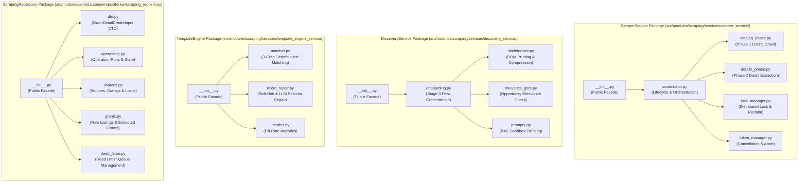

# Feature 2 Technical Remediation & Service Decomposition Plan

## 1. Executive Summary & Context

This remediation plan establishes the technical implementation strategy to resolve the seven blocking findings and code quality issues documented in [`docs/reports/scraping_extraction_pipeline/code_and_test_review/code_and_test_review_report.md`](file:///home/abood/Project/Afaq/Afaq-AI-Service/docs/reports/scraping_extraction_pipeline/code_and_test_review/code_and_test_review_report.md).

The primary architectural enhancement is decomposing large "God" files into modular subpackages using Python's package facade pattern (`__init__.py` serving as the package index). This pattern eliminates cognitive complexity bottlenecks, improves testability and maintainability, raises the KG-ARCHMAP architecture health score to $\ge 90$ (Grade A), and guarantees 100% backward compatibility for all external callers.

---

## 2. Architecture & Service Decomposition Strategy



### 2.1. Public Facade Guarantees
Each decomposed directory exposes its main class directly through its `__init__.py`. As a result, existing import statements remain completely valid:
```python
# Unbroken external imports:
from src.modules.scraping.services.scraper_service import ScraperService
from src.modules.scraping.services.discovery_service import DiscoveryService
from src.modules.scraping.services.template_engine_service import TemplateEngineService
from src.modules.core.database.repositories.scraping_repository import ScrapingRepository
```

---

## 3. Detailed Component Technical Changes

### 3.1. Production Entrypoint & Route Mounting
- **Problem:** [`src/main.py`](file:///home/abood/Project/Afaq/Afaq-AI-Service/src/main.py) omitted `scrape.router`. An isolated file `src/api/app.py` was used only in tests, leaving production deployments (`uvicorn src.main:app`) returning 404 for all scraping endpoints.
- **Implementation:**
  1. Mount `scrape.router` in [`src/main.py`](file:///home/abood/Project/Afaq/Afaq-AI-Service/src/main.py):
     ```python
     from src.api.routes.v1 import health, scrape, security, webhook
     ...
     app.include_router(scrape.router)
     ```
  2. Remove `src/api/app.py`.
  3. Update [`tests/integration/modules/scraping/conftest.py`](file:///home/abood/Project/Afaq/Afaq-AI-Service/tests/integration/modules/scraping/conftest.py):
     ```python
     from src.main import app
     ```

### 3.2. Prioritization Formula Correction (FR-007)
- **Problem:** [`PrioritizationService`](file:///home/abood/Project/Afaq/Afaq-AI-Service/src/modules/scraping/services/prioritization_service.py) used weights `1.0, 2.0, 5.0` instead of the mandated formula in FR-007.
- **Specification:** $\text{Score} = (\text{Admin Tier} \times 100) + \text{Days Since Last Scrape} - (\text{Consecutive Failures} \times 10)$.
- **Implementation:**
  Update constants in [`prioritization_service.py`](file:///home/abood/Project/Afaq/Afaq-AI-Service/src/modules/scraping/services/prioritization_service.py):
  ```python
  DEFAULT_BASE_PRIORITY_WEIGHT: float = 100.0
  DEFAULT_DAYS_SINCE_SCRAPE_WEIGHT: float = 1.0
  DEFAULT_CONSECUTIVE_FAILURES_PENALTY: float = 10.0
  ```
  Update assertions in [`tests/unit/modules/scraping/test_prioritization_service.py`](file:///home/abood/Project/Afaq/Afaq-AI-Service/tests/unit/modules/scraping/test_prioritization_service.py).

### 3.3. Concurrency, Cancellation & Null-Safety
- **Problem:** `source_token.is_set()` crashes with `AttributeError` when `source_token is None`. Swallowing `asyncio.CancelledError` prevents proper asyncio cancellation.
- **Implementation:**
  1. In `scraper_service/catalog_phase.py` and `details_phase.py`:
     ```python
     if (operation_token and operation_token.is_set()) or (
         source_token is not None and source_token.is_set()
     ):
         raise asyncio.CancelledError(f"Crawl halted for source {source.id}")
     ```
  2. In `scraper_service/coordinator.py`: Re-raise `asyncio.CancelledError` on operation-level cancellation after releasing locks and writing error summaries.
  3. In `scraper_service/details_phase.py`: Add safe dereference for `hero_img`:
     ```python
     if hero_img is not None and hasattr(hero_img, "get"):
         image_url = hero_img.get("src")
     ```

### 3.4. Dependency Injection & Clean API Contracts
- **Problem:** [`src/api/routes/v1/scrape.py`](file:///home/abood/Project/Afaq/Afaq-AI-Service/src/api/routes/v1/scrape.py) duplicates singleton container logic and returns untyped `dict[str, Any]` on `/operations/latest` and `/operations/{id}`.
- **Implementation:**
  1. Remove duplicate singletons from `scrape.py`.
  2. Inject `get_scraper_service` and `get_discovery_service` directly from [`src/api/protocols.py`](file:///home/abood/Project/Afaq/Afaq-AI-Service/src/api/protocols.py).
  3. Wrap responses in explicit Pydantic response models (`response_model=ScrapeOperationEnvelope` or `response_model=ScrapeOperationResponse`).
  4. In `POST /sources/onboard`, catch explicit domain exceptions (`SecurityValidationError`, `SSRFAttemptBlockedError`, `AccessChallengeBlockedError`) and let unexpected exceptions propagate to global 500 handlers.

### 3.5. Security Encapsulation & Repository DTO
- **Problem:** `crawler_service.py` calls private `LinkValidatorService._is_blocked_ip(host)`. `ScrapingRepository.create_grant_detail` takes 19 parameters (SonarQube S107 violation).
- **Implementation:**
  1. Expose public helper on [`LinkValidatorService`](file:///home/abood/Project/Afaq/Afaq-AI-Service/src/modules/security/services/link_validator_service.py):
     ```python
     @classmethod
     def is_ip_blocked(cls, ip_str: str) -> bool:
         """Public helper to verify if an IP address violates SSRF blocklist."""
         return cls._is_blocked_ip(ip_str)
     ```
  2. Update [`crawler_service.py`](file:///home/abood/Project/Afaq/Afaq-AI-Service/src/modules/scraping/services/crawler_service.py) to call `LinkValidatorService.is_ip_blocked(host)`.
  3. Define `GrantDetailCreateInput` Pydantic model in `scraping_repository/dto.py` and accept this single input object in `create_grant_detail`.

### 3.6. Code Smells & Deprecations
- **Problem:** BeautifulSoup `find_all(text=...)` triggers 8 deprecation warnings and Sonar code smells (`python:S8900`). Duplicate `"html.parser"` literals exist across modules.
- **Implementation:**
  1. Replace `find_all(text=...)` with `find_all(string=...)` in `discovery_service/skeletonizer.py`.
  2. Centralize `HTML_PARSER = "html.parser"` at package root.

### 3.7. Test Suite Optimization
- **Problem:** [`tests/unit/modules/scraping/test_models.py`](file:///home/abood/Project/Afaq/Afaq-AI-Service/tests/unit/modules/scraping/test_models.py) contains 352 lines testing standard Pydantic instantiation and defaults, which is explicitly discouraged by `AGENT.md` and increases test execution time.
- **Implementation:**
  Prune trivial model tests, retaining only tests that cover custom model validators, regex logic, and transformation methods. Verify that the entire test suite runs in $\le 15$ seconds.

---

## 4. Verification and Quality Gates

All fixes will be validated against the 10 diagnostic gates:
1. `uv run ruff check src/ tests/` (0 errors)
2. `uv run black --check src/ tests/` (0 files modified)
3. `uv run pytest tests/unit/modules/scraping/ tests/integration/modules/scraping/ -v` (100% pass)
4. `uv run pytest tests/architecture/ -v` (5/5 pass)
5. `archmap analyze src --fail-on-cycles --fail-on-layer-violations` (Score $\ge 90$, Grade A)
6. `enola check . --fail-on=layers,cycles` (0 layer or cycle violations)
7. `gitleaks detect --source . -v` (0 leaks)
8. `trivy fs . --scanners vuln --pkg-types library --severity HIGH,CRITICAL --skip-db-update` (0 critical vulnerabilities)
9. Full test suite execution duration $\le 15$ seconds
10. `node /home/abood/.gemini/config/plugins/oh-my-antigravity/scripts/verify-ledger.js --mode strict` (0 issues)
