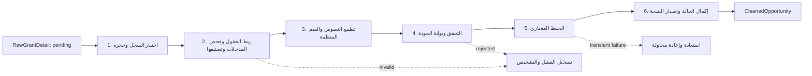

# متطلبات Feature 3: خدمة تنظيف البيانات

- **الحالة:** مسودة متطلبات منظمة حسب مراحل المعالجة
- **النطاق:** تحويل سجلات scraping الخام المحفوظة في `RawGrantDetail` إلى سجلات فرص معيارية في `CleanedOpportunity`، صالحة للاستهلاك اللاحق.
- **ملاحظة:** هذه المتطلبات تنظّم المتفق عليه حتى الآن. البنود المعلمة «قرار مطلوب» تحتاج حسمًا قبل التنفيذ؛ لا تفترض هذه الوثيقة تفاصيل غير محسومة.

## نظرة عامة على التدفق

تُعالج السجلات كلٌ على حدة حتى لا يمنع فشل سجل واحد استمرار بقية الدفعة. تبقى البيانات الخام الأصلية مرجعًا غير قابل للاستبدال.

---

## المرحلة 1: اختيار السجل وحجزه

### الهدف والحدود

اختيار سجلات `RawGrantDetail` المؤهلة للتنظيف ومنع معالجتها بالتوازي من أكثر من worker.

### المتطلبات الوظيفية

- **FR-1.1** يجب أن يختار النظام سجل `RawGrantDetail` إذا كانت حالته `pending`، وكان `retry_count < max_retries`، ولم يكن مرتبطًا بسجل `CleanedOpportunity` ناجح.
- **FR-1.2** يجب ألا يختار النظام السجلات ذات الحالة `failed_permanently` تلقائيًا؛ تتطلب إعادة إدخالها إلى المعالجة إجراء reset صريحًا.
- **FR-1.3** يجب أن يحجز السجل أو يطالب به بصورة تمنع عاملين متزامنين من تنفيذ التنظيف للسجل نفسه. يجوز استعادة السجل ذي حالة `processing` فقط إذا انتهت مدة lease الخاصة به.
- **FR-1.4** يجب أن يقرأ النظام الحد الأقصى لعدد workers المتزامنة من settings registry في قاعدة البيانات عند بدء العملية، ويستخدم القيمة المقروءة طوال مدة العملية.
- **FR-1.5** يجب أن يدعم تشغيل التنظيف على دفعات، مع عزل نتيجة كل سجل.
- **FR-1.6** يجب أن يحتفظ كل سجل خام بعلاقته بالمصدر و`operation_id` و`listing_id` و`opportunity_group_id` عند توفرها.

### المتطلبات غير الوظيفية

- **NFR-1.1** يجب أن يكون الحجز ذريًا أو محميًا بآلية قاعدة بيانات تضمن عدم المعالجة المكررة بالتزامن.
- **NFR-1.2** يجب أن تنتهي lease بعد 5 دقائق ما لم يجددها worker الذي ما زال يعالج السجل.
- **NFR-1.3** يجب أن يعيد النظام إتاحة سجل `processing` للاستلام بعد انتهاء lease دون الحاجة إلى تعديل يدوي.
- **NFR-1.4** يجب ألا يؤدي تعطل worker أو انقطاعه إلى بقاء السجل محجوزًا إلى أجل غير محدد.
- **NFR-1.5** يجب ألا يعتمد الاختيار أو الحجز على مصدر خارجي أو اتصال شبكي.
- **NFR-1.6** يجب ألا تؤثر تغييرات settings registry بعد بدء العملية في حد workers الخاص بالعملية الجارية؛ تُعتمد القيمة الجديدة عند قراءة الإعدادات في بدء العملية التالية.

### قصة المستخدم

بصفتي مشغّلًا لخدمة التنظيف، أريد أن تُلتقط السجلات الخام المؤهلة مرة واحدة لكل محاولة، حتى لا ينشئ التوازي سجلات معيارية مكررة.

### الحالات الطرفية

- وجود سجل بحالة `processing` بعد توقف worker: يعاد استلامه بعد انتهاء lease.
- بدء عاملين في الوقت نفسه ومحاولتهما حجز السجل ذاته: ينجح حجز واحد فقط.
- بلوغ `retry_count` قيمة `max_retries`: لا يُختار السجل تلقائيًا، ويُعالج وفق سياسة الفشل النهائي.
- وجود سجل `CleanedOpportunity` ناجح مسبقًا مع بقاء الحالة الخام `pending`: يستبعد لمنع التكرار، وتُسجل حالة عدم الاتساق للتشخيص.
- تغيير قيمة حد workers في settings registry أثناء عمل دفعة: تستمر العملية الجارية باستخدام القيمة التي قرأتها عند البدء، وتعتمد العملية التالية القيمة الجديدة عند قراءة الإعدادات.
- وجود سجلات كثيرة في دفعة واحدة؛ يجب ألا يؤدي ذلك إلى استهلاك ذاكرة غير محدود.
- تزامن حذف أو تعديل السجل الخام مع محاولة حجزه.

---

## المرحلة 2: ربط الحقول وفحص المدخلات وتصنيفها

### الهدف والحدود

فحص بنية `raw_payload`، وربط مفاتيح scraping المعروفة بمقابلاتها المعيارية المستخدمة في النظام وقاعدة البيانات، ثم فحص الحقول المعيارية المطلوبة وتصنيف الناتج إلى `ready` أو `incomplete` أو `invalid`. ناتج المرحلة JSON يتضمن الحقول المعيارية وقيمها المستخرجة، مع التصنيف والحقول المفقودة وأسباب التصنيف. هذا ربط مفاهيمي للقيم فقط؛ لا يتضمن البحث في قاعدة البيانات أو إنشاء علاقات فعلية أو FK mapping. لا تطبع المرحلة القيم أو تعدل البيانات الخام، وتبقى الحقول غير المعروفة محفوظة كما وردت في `raw_payload`.

### المتطلبات الوظيفية

- **FR-2.1** يجب التحقق من أن `raw_payload` كائن JSON صالح وقابل للفحص.
- **FR-2.2** يجب اعتبار محتوى المنحة/الفرصة واسم الجهة المقدمة من الحقول الأساسية: إذا غاب أي منهما أو كان نصه بعد إزالة المسافات بطول حرفين أو أقل، يصنف المدخل `invalid`.
- **FR-2.3** يجب اعتبار قيمة الحقل الرقمي الفارغة غير موجودة؛ ويحدد تصنيف السجل وفق أهمية ذلك الحقل في قواعد هذه المرحلة، لا وفق كونه رقميًا.
- **FR-2.4** يجب تصنيف المدخل `incomplete` إذا كان المحتوى الأساسي واسم الجهة موجودين وصالحين، لكن غاب حقل مطلوب قبل النشر. رابط التقديم `application_url` حقل مطلوب؛ غيابه يجعل السجل `incomplete` ويستلزم مراجعة بشرية قبل النشر.
- **FR-2.5** يجوز تصنيف المدخل `ready` إذا توفرت الحقول المطلوبة للنشر، ومنها اسم الجهة، محتوى الفرصة، `title`، رابط التقديم، والموعد النهائي. الحقول الإلزامية الأخرى التي لا يستطيع النظام توليدها تُعامل وفق قائمة النشر المعتمدة.
- **FR-2.6** يجب تصنيف المدخل `incomplete` إذا كان `title` مفقودًا أو فارغًا أو لا يتجاوز حرفين بعد trimming؛ يُحال إلى مراجعة بشرية لإسناد عنوان، ولا يولد النظام العنوان تلقائيًا.
- **FR-2.7** لا يؤثر غياب `source_url` (رابط صفحة الفرصة في منصة المصدر) أو رابط بوابة المصدر على تصنيف هذه المرحلة؛ كلاهما بيانات اختيارية للمستخدم النهائي. تبقى علاقة المصدر التقنية، إن كانت مطلوبة للتتبع، خارج فحص وجود روابط العرض.
- **FR-2.8** يجب تعريف mapping موثق من مفاتيح payload المعروفة إلى أسماء الحقول المعيارية المستخدمة في النظام وقاعدة البيانات.
- **FR-2.9** يجب دعم aliases المعتمدة لمفهوم الحقل نفسه عند اختلاف مواقع scraping أو صيغ المفاتيح.
- **FR-2.10** يجب أن ينتج mapping كائن JSON بأسماء الحقول المعيارية وقيمها المستخرجة من scraping. ويجب أن يتضمن الناتج تصنيف السجل والحقول المفقودة وأسباب التصنيف بما يكفي لتوجيهه للمسار المناسب؛ أما تفاصيل شكل JSON الدقيقة فتُحسم في مرحلة التخطيط.
- **FR-2.11** يجب أن يشمل mapping الحقول المعروفة، بما فيها العنوان والجهة والوصف والأهلية والموقع والتمويل والموعد والرابط والدولة ومستويات الدراسة ومجالاتها، وفق الحقول التي يدعمها النموذج المعياري.
- **FR-2.12** يجب أن يستند تصنيف `ready` أو `incomplete` أو `invalid` إلى القيم بعد ربط مفاتيح payload بالحقول المعيارية وقواعد الحقول المطلوبة.
- **FR-2.13** يجب تسجيل الحقول المفقودة وأسباب التصنيف وتوجيه كل فئة إلى مسارها، دون إجراء أي lookup أو FK mapping إلى `Institutions` أو غيرها من جداول قاعدة البيانات.
- **FR-2.14** يجب عدم استنتاج معنى حقل مجهول أو ربطه بحقل معياري دون قاعدة mapping معلنة. تبقى الحقول الإضافية غير المستخدمة كما هي في `raw_payload` دون تعديل أو حذف.
- **FR-2.15** يجب الاحتفاظ بالقيم الخام اللازمة للتشخيص عند فشل mapping أو غموضه، مع الحفاظ على `raw_payload` كما استُلم وعدم استبداله بنسخة mapped أو منظفة.

### المتطلبات غير الوظيفية

- **NFR-2.1** يجب أن تكون قواعد mapping والتصنيف محددة وحتمية وقابلة للتدقيق، بحيث ينتج عن المدخل نفسه ونسخة القواعد نفسها الناتج والتصنيف نفسيهما.
- **NFR-2.2** يجب ألا يتسبب سجل معطوب في إيقاف معالجة بقية الدفعة.
- **NFR-2.3** عند فحص الحقول النصية، يجب إزالة المسافات المحيطة لأغراض التحقق ثم اعتبار طول النص صالحًا فقط إذا تجاوز حرفين؛ لا يعني هذا تعديل القيمة المعيارية أو الخام المخزنة.
- **NFR-2.4** يجب أن يحافظ الفحص وmapping على `raw_payload` والحقول غير المعروفة دون أي تعديل.
- **NFR-2.5** يجب ألا تنفذ هذه المرحلة استعلامات ربط إلى جداول المؤسسات أو الدول أو التخصصات أو غيرها، ويجب ألا يعتمد منطق mapping المحض على اتصال قاعدة البيانات.
- **NFR-2.6** يجب ألا يتجاوز حجم `raw_payload` مقدار 5 MB.
- **NFR-2.7** يجب أن تكون قواعد mapping قابلة للاختبار والتعديل، وأن تسجل نسخة القواعد المستخدمة في تفسير الناتج.

### قصة المستخدم

بصفتي مشغّلًا لخدمة التنظيف، أريد تحويل مفاتيح scraping إلى أسماء الحقول المعيارية ثم التحقق من المحتوى الأساسي والحقول المطلوبة وتصنيف النتيجة إلى `ready` أو `incomplete` أو `invalid`، حتى لا تنتقل المدخلات غير المناسبة إلى مسار النشر دون مراجعة.

### الحالات الطرفية

- `raw_payload` مفقود أو null أو ليس JSON object أو غير قابل للتحليل: `invalid`.
- محتوى المنحة/الفرصة أو اسم الجهة مفقود، فارغ بعد trimming، أو طوله حرفان أو أقل: `invalid`.
- رابط التقديم `application_url` مفقود أو فارغ: `incomplete`؛ لا يُنشر السجل قبل استكماله ومراجعته.
- قيمة رقمية فارغة: تعامل كحقل غائب؛ إذا كانت مطلوبة للنشر يصبح السجل `incomplete`، وإذا لم تكن مطلوبة فلا تمنع `ready`.
- عنوان `title` مفقود أو فارغ أو بطول حرفين أو أقل بعد trimming: `incomplete`، ويحتاج إلى مراجعة بشرية لإسناد عنوان.
- رابط صفحة الفرصة في المصدر أو رابط بوابة المصدر مفقود: لا يؤثر في تصنيف هذه المرحلة.
- وجود اسم جهة صالح لكن لم يُربط بعد بصف `Institutions`: لا يؤثر في هذه المرحلة؛ المطابقة تتم في مرحلة لاحقة.
- وجود حقول إضافية غير معروفة أو غير مستخدمة: لا تُفسر ولا تعدل؛ تظل محفوظة في `raw_payload`.
- وجود أكثر من alias للمفهوم نفسه بقيم متعارضة: يسجل الغموض ولا تُختار قيمة بصمت؛ يحدد مسار التصنيف وفق أثر الحقل على الحقول المطلوبة.
- وصول حقل متوقع كـ scalar مرة وكقائمة أو كائن مرة أخرى: يسجل عدم توافق البنية ولا يُجرى تحويل تخميني.
- اختلاف أسماء الحقول أو بنيتها بعد تغيير قالب scraping: لا تُطبق إلا aliases وقواعد mapping المعلنة.
- وجود بيانات فرصة واحدة بلغات متعددة أو موزعة على صفحات فرعية: لا تدمج أو تترجم القيم تلقائيًا؛ تحفظ وفق قواعد mapping المعتمدة.
- JSON يتجاوز 5 MB أو يتجاوز حد عمق التحليل المعتمد: لا يمر إلى mapping والتصنيف المعتاد؛ يعالج كمدخل غير صالح وفق سياسة المرحلة.

---
## المرحلة 3: تطبيع النصوص والقيم المنظمة

### الهدف والحدود

تحويل القيم المعروفة إلى صيغ معيارية مع الحفاظ على النص الأصلي عندما لا يكون التحليل موثوقًا. قد يقوم scraping مسبقًا بـ plain-text extraction أو safe HTML sanitization؛ لذلك لا يُعاد هذا العمل إلا وفق عقد واضح.

### المتطلبات الوظيفية

- **FR-3.1** يجب تطبيع المسافات وUnicode باستخدام NFKC حيث لا يؤدي ذلك إلى فقدان معنى النص.
- **FR-3.2** يجب إزالة محارف التحكم غير القابلة للطباعة وفك HTML entities المتبقية عند الحاجة.
- **FR-3.3** يجب تحويل التاريخ الواضح إلى صيغة معيارية متوافقة مع ISO 8601 أو النوع الزمني المحدد في قاعدة البيانات.
- **FR-3.4** يجب تحليل مبالغ التمويل وعملاتها وتواترها ونوع التمويل عند وضوحها، مع الاحتفاظ بالنص الأصلي عند غموضها.
- **FR-3.5** يجب توحيد رموز الدول إلى ISO 3166-1 alpha-2 والعملات إلى ISO 4217 عند دعم mapping موثوق.
- **FR-3.6** يجب ربط أسماء الدرجات ومجالات الدراسة وأنواع الفرص إلى taxonomy معتمدة، دون إسقاط القيم غير المعروفة بصمت.
- **FR-3.7** يجب صيانة النص العربي والإنجليزي المختلط واتجاه RTL دون تغيير دلالته.
- **FR-3.8** عند وجود وصف غني، يجب الحفاظ على safe HTML أو تحويله إلى نص وفق عقد التخزين النهائي؛ يجب عدم تطبيق sanitizer مرتين بلا حاجة.

### المتطلبات غير الوظيفية

- **NFR-3.1** يجب أن تكون التحويلات حتمية وقابلة لإعادة الإنتاج.
- **NFR-3.2** يجب تجنب coercion أو parsing التخَميني الذي يغير المعنى.
- **NFR-3.3** يجب أن تكون القواعد قابلة للنسخ بالإصدار حتى يمكن تفسير نتائج إعادة التنظيف.
- **NFR-3.4** يجب ألا تنفذ المرحلة network access أو تستعلم خدمة خارجية لحل الرموز.

### قصة المستخدم

بصفتي طالبًا يقارن فرصًا متعددة، أريد رؤية المواعيد والتمويل والدول بصيغ متسقة، مع بقاء المعلومات الأصلية عندما يتعذر تفسيرها بثقة.

### الحالات الطرفية

- تاريخ رقمي ملتبس مثل `03/04/2027`، أو تاريخ هجري/ميلادي، أو تاريخ نسبي مثل “next month”.
- موعد ماضٍ أو تاريخ غير ممكن أو منطقة زمنية غير معروفة.
- مبالغ بصيغ عربية/إنجليزية، فواصل آلاف عشرية مختلفة، نطاقات، اختصارات، أو عملة مجهولة.
- عبارة “fully funded” دون مبلغ رقمي.
- دولة متعددة أو اسم بلد alias أو أهلية عالمية/عن بعد.
- مصطلحات درجات أو مجالات غير معروفة أو مختلطة.
- HTML تالف أو متداخل، وسوم script، محارف RTL مخفية، أو نص طويل جدًا.
- قد يغير NFKC تمثيل رمز أو شكل نص في سياق مخصوص؛ يجب اختبار الحقول الحساسة وعدم تطبيقه بعمومية عمياء.

---

## المرحلة 4: التحقق وبوابة الجودة

### الهدف والحدود

التأكد من أن السجل المعياري متسق بما يكفي للتخزين والاستهلاك، وتصنيف النقص والالتباس دون اختلاق بيانات.

### المتطلبات الوظيفية

- **FR-4.1** يجب التحقق من الأنواع والقيود وقواعد الاتساق للحقول المعيارية.
- **FR-4.2** يجب تحديد الحقول المطلوبة للنشر؛ ويُتوقع مبدئيًا أن يكون `title` و`source_url` إلزاميين وفق schema.
- **FR-4.3** يجب التمييز بين missing وinvalid وambiguous وvalid لكل حقل قابل للتحليل.
- **FR-4.4** يجب منع السجلات التي لا تجتاز بوابة النشر من الوصول إلى publication-ready status.
- **FR-4.5** يجب أن تتضمن نتيجة التحقق أخطاء وتحذيرات ذات أسماء حقول وأسباب واضحة.
- **FR-4.6** يجب فصل اكتمال الحقول عن صحة السجل: قد يكون حقل اختياري غير موجود دون أن يجعل السجل مرفوضًا. **قرار مطلوب:** quality thresholds.

### المتطلبات غير الوظيفية

- **NFR-4.1** يجب أن تكون أسباب الرفض قابلة للتدقيق ولا تعتمد على رسائل استثناء عامة فقط.
- **NFR-4.2** يجب أن تكون بوابة الجودة حتمية ومعلنة؛ لا تعتمد على تقييم LLM غير قابل للتكرار.
- **NFR-4.3** يجب أن تسمح النتائج بتوجيه السجل للمراجعة البشرية عند الحاجة دون فقد معلومات.

### قصة المستخدم

بصفتي مسؤول نشر، أريد ألا تظهر الفرص التي تفتقر إلى الحد الأدنى من المعلومات أو تحوي قيماً متناقضة، وأريد معرفة سبب حجبها.

### الحالات الطرفية

- عنوان فارغ أو مكوّن بالكامل من markup/مسافات.
- رابط مصدر أو تقديم غير صالح شكليًا؛ خدمة التنظيف لا تتحقق منه شبكيًا.
- موعد يسبق تاريخ البدء أو قيم مالية متناقضة.
- وصف أو أهلية غير موجودة مع وجود title صالح.
- حقول كثيرة مجهولة مع سجل يمكن أن يكون صالحًا أساسياً.
- صيغة صحيحة نوعيًا لكنها خارج نطاق منطقي مثل confidence أكبر من 1.

---

## المرحلة 5: الحفظ المعياري

### الهدف والحدود

حفظ `CleanedOpportunity` بعد اجتياز التحقق وربطه بالسجل الخام والمصدر، مع حماية retries والتوازي من التكرار أو الحالة الجزئية.

### المتطلبات الوظيفية

- **FR-5.1** يجب حفظ السجل المعياري مرتبطًا بـ `raw_grant_detail_id` و`source_id` و`source_url` وفق مخطط البيانات المتفق عليه.
- **FR-5.2** يجب أن تكون عملية الحفظ idempotent وفق مفتاح uniqueness معتمد. **قرار مطلوب:** اختيار المفتاح وسياسة تحديث السجل الموجود.
- **FR-5.3** يجب عدم إنشاء سجل `CleanedOpportunity` لناتج فشل بوابة الجودة على أنه صالح للنشر.
- **FR-5.4** يجب حفظ content hash عند تعريف قواعده، والتعامل مع hash collisions أو تغير قواعد hash بسياسة واضحة.
- **FR-5.5** يجب ألا تتحول حالة raw إلى cleaned إلا عند نجاح حفظ الناتج.
- **FR-5.6** يجب تحديد كيفية إعادة التنظيف عند تغير mappings أو قواعد normalization: تحديث مباشر، إصدار جديد، أو مراجعة. **قرار مطلوب.**

### المتطلبات غير الوظيفية

- **NFR-5.1** يجب استخدام transaction أو مسار استعادة يضمن اتساق كتابة canonical record مع تحديث lifecycle.
- **NFR-5.2** يجب أن تتحمل العملية retry بعد timeout أو فشل اتصال دون تكرار البيانات.
- **NFR-5.3** يجب أن تمر تغييرات schema عبر Prisma migrations بعد اعتماد baseline، لا عبر تعديل يدوي لقاعدة الإنتاج.
- **NFR-5.4** يجب أن يبقى repository access خارج وظائف التحويل المحضة.

### قصة المستخدم

بصفتي مشغّلًا، أريد أن تكون نتيجة التنظيف محفوظة مرة واحدة ومتصلة بسجلها الخام، حتى تعمل retries دون تكرار أو فقد provenance.

### الحالات الطرفية

- تعطل الاتصال بعد commit وقبل تأكيد النتيجة للـ worker.
- نجاح حفظ cleaned record وفشل تحديث raw status أو العكس.
- تعارض workers على uniqueness key.
- وجود cleaned record سابق من إصدار قواعد أقدم.
- حذف المصدر أو raw record أثناء الحفظ.
- content hash متكرر لسجلين مختلفين أو اختلاف بسيط في المحتوى.
- المخطط المحلي لا يطابق Prisma schema أو migration baseline.

---

## المرحلة 6: إكمال الحالة وإصدار النتيجة

### الهدف والحدود

إغلاق دورة المعالجة وتسجيل النتيجة وإتاحة السجل المؤهل لمستهلكيه دون خلط التنظيف بقرار النشر النهائي.

### المتطلبات الوظيفية

- **FR-6.1** يجب تحديث lifecycle status إلى cleaned بعد نجاح التحقق والحفظ فقط.
- **FR-6.2** يجب تسجيل نجاح أو تحذيرات أو فشل دائم مع ارتباط واضح بالسجل الخام.
- **FR-6.3** يجب تصنيف أخطاء التشغيل القابلة للاستعادة، مثل انقطاع قاعدة البيانات، منفصلة عن أخطاء المحتوى غير القابلة للاستعادة دون تغيير المدخل.
- **FR-6.4** يجب أن تكون نتيجة كل سجل قابلة للاستهلاك من application service أو job orchestration، دون إدخال transport concerns إلى domain module.
- **FR-6.5** يجب إتاحة السجلات الناجحة لمستهلكي publication وmatching وفق حالة quality gate. لا يعني `cleaned` بالضرورة أن السجل منشور.
- **FR-6.6** يجب تسجيل cleaning rules version وملخص التشخيص اللازمين لتفسير النتيجة.

### المتطلبات غير الوظيفية

- **NFR-6.1** يجب أن تكون سجلات التشغيل كافية للتدقيق دون تسجيل أسرار أو نسخ payload كامل في logs.
- **NFR-6.2** يجب قياس أعداد success/warning/rejected/retryable/permanent failure لكل دفعة.
- **NFR-6.3** يجب ألا يؤدي فشل إشعار أو مستهلك لاحق إلى إلغاء سجل محفوظ بنجاح؛ يلزم فصل المسؤوليات أو آلية retry. **قرار مطلوب:** آلية الإشعار والتكامل.

### قصة المستخدم

بصفتي مسؤولًا عن تدفق البيانات، أريد معرفة نتائج كل دفعة وتمييز ما أصبح جاهزًا للمستهلكين عما يحتاج مراجعة أو retry.

### الحالات الطرفية

- حفظ السجل بنجاح وفشل إرسال event أو webhook.
- سجلات تبقى processing بسبب crash أو إلغاء العملية.
- تكرار event أو تسليمه بترتيب مختلف.
- تراكم retryable failures بما يحجب pending records.
- قبول السجل للتنظيف لكنه غير مؤهل للنشر أو matching.
- logging لتشخيص الخطأ قد يحتوي نصًا شخصيًا أو حساسًا من محتوى المصدر.

---

## متطلبات مشتركة بين المراحل

### متطلبات وظيفية

- **FR-C.1** يجب عدم إجراء network calls أو DNS resolution أو تشغيل browser أو تنزيل مرفقات داخل cleaning.
- **FR-C.2** يجب عدم تعديل بيانات scraping الخام أو تجاوز نتائج التحقق الأمني السابقة.
- **FR-C.3** يجب الاحتفاظ باللغة و`opportunity_group_id` للسجلات ثنائية اللغة دون ترجمة المحتوى أو دمج النصوص تلقائياً.
- **FR-C.4** يجب التعامل مع فشل سجل منفرد دون إيقاف باقي الدفعة.
- **FR-C.5** يجب دعم إعادة المعالجة وفق سياسة واضحة تحفظ traceability إلى نسخة القواعد المستخدمة.

### متطلبات غير وظيفية

- **NFR-C.1** يجب أن يكون منطق التحويل deterministic وtestable وقليل الاعتماديات.
- **NFR-C.2** يجب تطبيق حدود لحجم payload والنصوص والعمق لمنع resource exhaustion.
- **NFR-C.3** يجب ألا تحتوي logs على credentials أو البيانات الخام كاملة بلا حاجة.
- **NFR-C.4** يجب قياس الجودة والتغطية التشغيلية دون وضع latency assertions ضمن الاختبارات الوظيفية.

## القرارات المطلوبة قبل اعتماد المتطلبات للتنفيذ

1. عقد payload الفعلي: أسماء المفاتيح، aliases، وأنواع الحقول.
2. قائمة بقية حقول النشر المطلوبة التي لا يستطيع النظام توليدها تلقائيًا، بالإضافة إلى الحقول المحسومة هنا: محتوى الفرصة، اسم الجهة، `title`، رابط التقديم، والموعد النهائي.
3. تحديد مسارات التعامل التشغيلية مع `ready` و`incomplete` و`invalid` وكيفية إعادة فحص `incomplete` بعد استكماله.
4. حد حجم `raw_payload` محسوم بـ 5 MB؛ ما زال تحديد حدود النصوص والدفعات مطلوبًا.
5. الحد الأدنى لبوابة الجودة والنشر؛ الحقول الإلزامية والاختيارية.
6. سياسة parsing للتواريخ الهجرية، المناطق الزمنية، والتواريخ الملتبسة.
7. تمثيل التمويل: المبلغ، العملة، النطاق، التواتر، والوصف الحر.
8. سياسة تخزين description: safe HTML أم plain text، وموضع sanitization منعًا للتكرار.
9. lifecycle states ومدة claim وretry/backoff وdead-letter behavior.
10. مفتاح idempotency وuniqueness، وسياسة تحديث cleaned record الموجود.
11. versioning وإعادة التنظيف عند تحديث قواعد mappings.
12. سياسة ربط اللغات أو deduplication؛ المقترح الأولي حفظ كل لغة مستقلة وربطها عبر `opportunity_group_id`.
13. آلية تمرير النتائج إلى publication وmatching، مع إبقاء قرار النشر منفصلًا عن التنظيف.
14. مواءمة `CleanedOpportunity` مع المتطلبات النهائية وPrisma migration baseline قبل إضافة أي أعمدة أو جداول.
