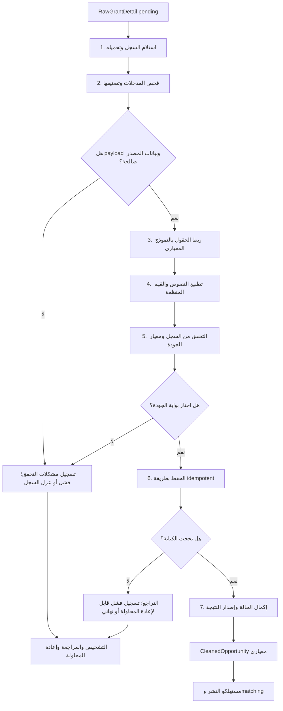

# مراحل خط تنظيف البيانات

يوضح هذا المخطط التدفق المقترح من مخرجات scraping المحفوظة إلى سجلات الفرص المعيارية. يحتفظ كل سجل بمرجعه إلى البيانات الخام، وتُعزل أخطاء السجلات حتى يستمر العمل على بقية الدفعة.

## عقود المراحل

1. **استلام السجل وتحميله:** اختيار السجلات المؤهلة بحالة pending وإنشاء claim آمن يمنع workers متزامنة من معالجة السجل نفسه.
2. **فحص المدخلات وتصنيفها:** التحقق من بنية payload ومعرّفات المصدر وبيانات اللغة والمجموعة وحدود حجم المدخلات. تبقى البيانات الخام الأصلية دون تعديل.
3. **ربط الحقول:** تحويل أسماء الحقول المعروفة والبدائل المرتبطة بالقوالب إلى النموذج المعياري. لا يُعاد تفسير الحقول غير المعروفة بصمت؛ تُسجل للتشخيص أو تُتجاهل وفق سياسة صريحة.
4. **التطبيع:** معالجة النصوص المتبقية وتوحيد Unicode والمسافات، وتحليل التواريخ والتمويل، وربط رموز الدول والدرجات والتصنيفات عند وضوح المعنى. عند الالتباس، يُحتفظ بالنص الأصلي.
5. **التحقق وبوابة الجودة:** فرض الحقول المطلوبة وقواعد الأنواع والاتساق. لا تُمرر السجلات الناقصة أو الملتبسة إلى النشر، وتُرفق بها ملاحظات على مستوى الحقل.
6. **الحفظ بطريقة idempotent:** حفظ السجل المعياري مع الربط إلى raw detail والمصدر، وفق مفتاح idempotency متفق عليه. تُستخدم transaction أو انتقالات حالة قابلة للاستعادة لمنع الحفظ الجزئي.
7. **الإكمال وإصدار النتيجة:** تحديث حالة الإدخال إلى cleaned بعد نجاح الحفظ فقط، وتسجيل إصدار قواعد التنظيف وملخص النتيجة، ثم إتاحة السجلات المؤهلة لتدفقات النشر وmatching.

## قواعد الفشل والاستعادة

- تُعزل الإخفاقات على مستوى السجل؛ ولا يوقف payload معطوب معالجة الدفعة كلها.
- يعاد تنفيذ الإخفاقات المؤقتة في worker أو التخزين، وتُحال السجلات غير الصالحة أو المستنفدة للمراجعة دون حذف بياناتها الخام.
- لا تنشئ إعادة المحاولة سجلات معيارية مكررة.
- لا تنفذ هذه العملية أي network requests أو تشغيل browser أو تنزيل ملفات خارجية.
- قد يكون scraping قد أزال markup ونظّف الأوصاف مسبقاً؛ لذا تُطبق فقط التحويلات المتبقية والتطبيع المعياري المتفق عليه لتجنب التنظيف المكرر أو فقدان المعنى.

## الحالة والقرارات المفتوحة

هذا تصميم مقترح مبني على مناقشة Feature 3. ما زالت أسماء حقول payload البديلة، وحدود الجودة، وحالات retry، ومفاتيح idempotency، وسياسة إعادة التنظيف وإصداراتها بحاجة إلى قرار.