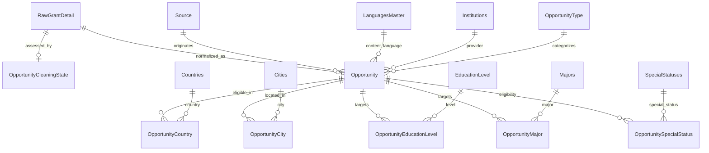

# مسودة المخطط الافتراضي لخدمة الفرص والتنظيف

- **الحالة:** Working draft للنقاش وطلب التغيير من مستودع قاعدة البيانات المركزي
- **النطاق:** جداول التنظيف والفرص المنشورة وعلاقاتها اللازمة فقط
- **ليست:** canonical `schema.prisma`، ولا migration، ولا تعليمات لتعديل قاعدة اختبار أو إنتاج
- **مرجع الملكية:** مستودع قاعدة البيانات المركزي وفق ADR 0003

## 1. الهدف وحدود المسودة

تعرّف هذه المسودة البيانات التي تحتاجها خدمة cleaning لإجراء input assessment وتصنيف السجل إلى `ready` أو `incomplete` أو `invalid`، وتحويل السجل المقبول إلى فرصة ذات علاقات مرجعية قابلة للاستهلاك من الخدمات الأخرى.

مدخل scraping القائم هو `RawGrantDetail` في `raw_grant_details`. تستهلكه خدمة التنظيف مع بيانات `Source` وبيانات اللغة والمجموعة. لا تعيد هذه المسودة تعريف جداول scraping المحسومة. يجب أن تُدمج المراجع إلى هذه الجداول في canonical schema المركزي، لا أن تنشأ migration محلية في مستودع الخدمة.

الجداول المرجعية التالية موجودة في مخطط core backend الحالي، وتُستخدم هنا كمرجع للعلاقات النهائية: `Countries`، `Cities`، `Institutions`، `Majors`، `MajorCategories`، `EducationLevel`، `LanguagesMaster`، و`SpecialStatuses`. يسمح بأن تظهر تعريفاتها في هذا working draft لغرض توضيح العلاقات؛ مستودع قاعدة البيانات المركزي هو من يقرر دمجها أو إزالة تعريفات مكررة بعد مقارنة التعريفات الفعلية.

## 2. مبادئ التصميم المقترحة

1. لا تُعدّل خدمة التنظيف `RawGrantDetail.raw_payload` أو حالة scraping الخاصة به؛ نتيجة الفحص وحالة عمل cleaning محفوظتان في جدول مستقل.
2. افصل **تصنيف المدخل** (`READY`, `INCOMPLETE`, `INVALID`) عن **حالة التنفيذ** (`PENDING`, `PROCESSING`, `COMPLETED`, `FAILED`). فالسجل قد يكون `INVALID` وقد اكتمل فحصه بنجاح.
3. احفظ أحدث assessment لكل raw record مع missing-fields diagnostics. الاحتفاظ بتاريخ كامل لكل محاولة قرار لاحق؛ لا تفترض المسودة جدول تاريخ إضافياً قبل حسم الحاجة.
4. الفرصة الناتجة مرتبطة بـ raw detail واحد. كل نسخة لغة تبقى فرصة مستقلة، وتُحفظ علاقة اللغات عبر `opportunity_group_id` القادم من scraping.
5. استخدم foreign keys إلى الكيانات المشتركة بدلاً من نسخ اسم الدولة أو المدينة أو الجهة أو التخصص أو مستوى الدراسة كنص معياري.
6. يمكن الاحتفاظ بنص العرض الأصلي عند الحاجة للعرض أو التدقيق، لكن لا يُستخدم بديلاً عن العلاقة المرجعية عندما تكون القيمة قد طابقت كياناً معروفاً.
7. الحقول الإلزامية لتصنيف Phase 2 ستُعتمد بعد مراجعة هذا المخطط وقواعد العمل؛ لا تستنتج من `NOT NULL` وحده أهلية النشر.

## 3. العلاقات



## 4. الجداول المقترحة

### 4.1 `OpportunityCleaningState` — تقييم ومدى معالجة سجل المصدر

سجل واحد لكل `RawGrantDetail`، upsert بمفتاح `raw_grant_detail_id`. لا يغيّر هذا الجدول status في `raw_grant_details`.

| الحقل | النوع المقترح | Null/default | الغرض |
| --- | --- | --- | --- |
| `id` | UUID | PK، generated | معرّف سجل التنظيف |
| `raw_grant_detail_id` | UUID | required، unique، FK → `raw_grant_details.id` | سجل المصدر الذي يجري فحصه |
| `processing_status` | enum | required، default `PENDING` | lifecycle: `PENDING`, `PROCESSING`, `COMPLETED`, `FAILED` |
| `input_classification` | enum | nullable | assessment: `READY`, `INCOMPLETE`, `INVALID`; null قبل الفحص |
| `missing_fields` | String[] | required، default `[]` | أسماء/مسارات الحقول الناقصة حسب classifier |
| `classification_diagnostics` | JSON | nullable | الأسباب التفصيلية وأخطاء البنية/التصنيف |
| `retry_count` | Int | required، default 0 | محاولات تشغيل التنظيف الفعلية |
| `max_retries` | Int | required، default 3 | سقف المحاولات؛ القيمة النهائية تحتاج مواءمة مع السياسة |
| `lease_owner` | String | nullable | هوية worker أو claim token |
| `lease_expires_at` | DateTime | nullable | انتهاء lease؛ الأساس 5 دقائق وفق الاتفاق |
| `heartbeat_at` | DateTime | nullable | آخر تجديد lease |
| `ruleset_version` | String | nullable | نسخة قواعد mapping/classification المستخدمة |
| `last_error_code` | String | nullable | تصنيف مختصر لآخر خطأ تشغيل |
| `last_error_message` | String | nullable | رسالة منقحة لا تتضمن payload الخام كاملاً |
| `assessed_at` | DateTime | nullable | وقت آخر تصنيف |
| `started_at` | DateTime | nullable | بداية آخر محاولة |
| `completed_at` | DateTime | nullable | نهاية آخر معالجة |

**قيود وفهارس مقترحة:**

- unique على `raw_grant_detail_id`.
- index على (`processing_status`, `lease_expires_at`) للـ claim واستعادة leases المنتهية.
- index على `input_classification` لتقارير جودة المدخلات.
- claim ذري يختار السجلات المؤهلة: المصدر ما زال ضمن حالة scraping التي تسمح بالمعالجة، و`retry_count < max_retries`، ولا يوجد `Opportunity` ناتج ناجح. لا تعاد `INVALID` تلقائياً دون reset/policy صريح.

### 4.2 `Opportunity` — السجل المعياري

السجل الذي تستهلكه API والخدمات. `Opportunity` هنا اسم مقترح، قابل للتعديل عند مواءمته مع canonical naming في مستودع قاعدة البيانات.

| الحقل | النوع المقترح | Null/default | الغرض |
| --- | --- | --- | --- |
| `id` | UUID | PK، generated | معرّف الفرصة |
| `raw_grant_detail_id` | UUID | required، unique، FK → `raw_grant_details.id` | provenance ومنع إنشاء opportunity مكررة من raw record واحد |
| `source_id` | UUID | required، FK → `sources.id` | مصدر الفرصة |
| `opportunity_group_id` | UUID | nullable | ربط نسخ اللغات للمصدر نفسه |
| `language_id` | UUID | nullable، FK → `languages_master.id` | لغة المحتوى؛ nullable عندما تكون اللغة غير معروفة |
| `provider_institution_id` | UUID | nullable، FK → `institutions.id` | الجامعة/الجهة عند مطابقتها بكيان معروف |
| `opportunity_type_id` | UUID | nullable، FK → `opportunity_types.id` | تصنيف موحد لنوع الفرصة |
| `title` | Text | required | عنوان الفرصة |
| `description` | Text | nullable | الوصف المنظف؛ الشكل (plain text أو safe HTML) قرار محتوى مفتوح |
| `eligibility_text` | Text | nullable | شروط الأهلية الوصفية غير القابلة بعد للربط الكامل |
| `application_url` | Text | nullable | رابط التقديم بعد التحقق upstream |
| `source_url` | Text | required | رابط الفرصة لدى المصدر |
| `funding_amount` | Decimal | nullable | المبلغ إذا كان قابلاً للتحليل |
| `funding_currency_code` | Char(3) | nullable | ISO 4217 عند معرفة العملة |
| `funding_description` | Text | nullable | تفاصيل التمويل النصية عند عدم كفاية الحقول المنظمة |
| `deadline` | DateTime | nullable | الموعد بعد التطبيع |
| `is_remote` | Boolean | nullable | هل الفرصة عن بعد إذا توفر دليل |
| `publication_status` | enum | required، default `DRAFT` | `DRAFT`, `PUBLISHED`, `ARCHIVED`; منفصل عن cleaning lifecycle |
| `content_hash` | String | nullable، unique | idempotency/deduplication، بعد تعريف خوارزمية مستقرة |
| `created_at` | DateTime | required، generated | وقت الإنشاء |
| `updated_at` | DateTime | required، managed | آخر تحديث |

**قرار mapping:** يجب أن ترتبط `provider_institution_id` بصف `Institutions` فقط عند وجود match موثوق. إذا لم تطابق الجهة، لا يُنشأ سجل مؤسسة تلقائياً؛ يمكن الاحتفاظ بالنص الأصلي داخل diagnostics أو إضافة حقل snapshot اختياري بعد حسم سياسة العرض.

### 4.3 `OpportunityCountry` — الدول المرتبطة بالأهلية

| الحقل | النوع المقترح | Null/default | الغرض |
| --- | --- | --- | --- |
| `opportunity_id` | UUID | required، FK → `opportunities.id` | الفرصة |
| `country_id` | UUID | required، FK → `countries.id` | دولة الأهلية/الاستهداف |

المفتاح المركب المقترح: (`opportunity_id`, `country_id`). وجود صفر صفوف يعني أن الدولة غير محددة أو أن الفرصة عالمية؛ يجب التمييز بين الحالتين إذا كان ذلك مهماً للنشر أو matching.

### 4.4 `OpportunityCity` — مواقع الدراسة/الاستضافة

| الحقل | النوع المقترح | Null/default | الغرض |
| --- | --- | --- | --- |
| `opportunity_id` | UUID | required، FK → `opportunities.id` | الفرصة |
| `city_id` | UUID | required، FK → `cities.id` | موقع الدراسة أو الاستضافة |

المفتاح المركب المقترح: (`opportunity_id`, `city_id`). يرتبط كل `Cities.country_id` ببلده المرجعي؛ لا تكرر الدولة كنص. الفرق بين «دولة الأهلية» و«مكان الدراسة» محفوظ في junction مختلف.

### 4.5 `OpportunityEducationLevel`

| الحقل | النوع المقترح | Null/default | الغرض |
| --- | --- | --- | --- |
| `opportunity_id` | UUID | required، FK → `opportunities.id` | الفرصة |
| `education_level_id` | UUID | required، FK → `education_levels.id` | الدرجة/المستوى المستهدف |

المفتاح المركب المقترح: (`opportunity_id`, `education_level_id`).

### 4.6 `OpportunityMajor`

| الحقل | النوع المقترح | Null/default | الغرض |
| --- | --- | --- | --- |
| `opportunity_id` | UUID | required، FK → `opportunities.id` | الفرصة |
| `major_id` | UUID | required، FK → `majors.id` | التخصص/المجال |

المفتاح المركب المقترح: (`opportunity_id`, `major_id`). تُستخدم `MajorCategories` عبر علاقة `Majors.category_id` الموجودة؛ لا نكرر category في opportunity.

### 4.7 `OpportunitySpecialStatus`

| الحقل | النوع المقترح | Null/default | الغرض |
| --- | --- | --- | --- |
| `opportunity_id` | UUID | required، FK → `opportunities.id` | الفرصة |
| `special_status_id` | UUID | required، FK → `special_statuses.id` | أهلية فئة خاصة |

المفتاح المركب المقترح: (`opportunity_id`, `special_status_id`). تُضاف هذه العلاقة فقط إذا كانت special-status eligibility ضمن بيانات الفرص فعلاً؛ تشابه الجدول مع متطلبات المستخدمين لا يكفي وحده لإثبات أن الدلالة نفسها تنطبق.

### 4.8 `OpportunityType` — taxonomy مملوك لمستودع قاعدة البيانات

| الحقل | النوع المقترح | Null/default | الغرض |
| --- | --- | --- | --- |
| `id` | UUID | PK، generated | معرّف النوع |
| `code` | String | required، unique | قيمة مستقرة مثل `SCHOLARSHIP` |
| `name_en` | String | required | الاسم الإنجليزي |
| `name_ar` | String | required | الاسم العربي |
| `is_active` | Boolean | required، default true | إيقاف النوع دون حذف علاقاته |

القيم النهائية للـ taxonomy وضرورة الجدول بدلاً من enum تحتاج اعتماداً من domain/product owners. لا يخزن النص الحر في `Opportunity.opportunity_type` كبديل دائم للتصنيف.

## 5. مخطط Prisma مفاهيمي للجداول التي يملكها نطاق الفرص

المقطع التالي يوضح الأسماء وأنواع العلاقات المقترحة فقط. ليس schema مستقلاً صالحاً للتطبيق قبل دمجه مع canonical models والجداول المرجعية في مستودع قاعدة البيانات المركزي.

```prisma
enum CleaningProcessingStatus {
  PENDING
  PROCESSING
  COMPLETED
  FAILED
}

enum InputClassification {
  READY
  INCOMPLETE
  INVALID
}

enum OpportunityPublicationStatus {
  DRAFT
  PUBLISHED
  ARCHIVED
}

model OpportunityCleaningState {
  id                       String                   @id @default(dbgenerated("gen_random_uuid()")) @db.Uuid
  rawGrantDetailId         String                   @unique @map("raw_grant_detail_id") @db.Uuid
  processingStatus         CleaningProcessingStatus @default(PENDING) @map("processing_status")
  inputClassification     InputClassification?     @map("input_classification")
  missingFields            String[]                 @default([]) @map("missing_fields")
  classificationDiagnostics Json?                   @map("classification_diagnostics")
  retryCount               Int                      @default(0) @map("retry_count")
  maxRetries               Int                      @default(3) @map("max_retries")
  leaseOwner               String?                  @map("lease_owner")
  leaseExpiresAt           DateTime?                @map("lease_expires_at") @db.Timestamptz(6)
  heartbeatAt              DateTime?                @map("heartbeat_at") @db.Timestamptz(6)
  rulesetVersion           String?                  @map("ruleset_version")
  lastErrorCode            String?                  @map("last_error_code")
  lastErrorMessage         String?                  @map("last_error_message")
  assessedAt               DateTime?                @map("assessed_at") @db.Timestamptz(6)
  startedAt                DateTime?                @map("started_at") @db.Timestamptz(6)
  completedAt              DateTime?                @map("completed_at") @db.Timestamptz(6)
  createdAt                DateTime                 @default(now()) @map("created_at") @db.Timestamptz(6)
  updatedAt                DateTime                 @updatedAt @map("updated_at") @db.Timestamptz(6)

  @@index([processingStatus, leaseExpiresAt])
  @@index([inputClassification])
  @@map("opportunity_cleaning_states")
}

model Opportunity {
  id                     String                     @id @default(dbgenerated("gen_random_uuid()")) @db.Uuid
  rawGrantDetailId       String                     @unique @map("raw_grant_detail_id") @db.Uuid
  sourceId               String                     @map("source_id") @db.Uuid
  opportunityGroupId     String?                    @map("opportunity_group_id") @db.Uuid
  languageId             String?                    @map("language_id") @db.Uuid
  providerInstitutionId  String?                    @map("provider_institution_id") @db.Uuid
  opportunityTypeId      String?                    @map("opportunity_type_id") @db.Uuid
  title                  String                     @db.Text
  description            String?                    @db.Text
  eligibilityText        String?                    @map("eligibility_text") @db.Text
  applicationUrl         String?                    @map("application_url") @db.Text
  sourceUrl              String                     @map("source_url") @db.Text
  fundingAmount          Decimal?                   @map("funding_amount") @db.Decimal(18, 2)
  fundingCurrencyCode    String?                    @map("funding_currency_code") @db.Char(3)
  fundingDescription     String?                    @map("funding_description") @db.Text
  deadline               DateTime?                  @db.Timestamptz(6)
  isRemote               Boolean?                   @map("is_remote")
  publicationStatus      OpportunityPublicationStatus @default(DRAFT) @map("publication_status")
  contentHash            String?                    @unique @map("content_hash")
  createdAt              DateTime                   @default(now()) @map("created_at") @db.Timestamptz(6)
  updatedAt              DateTime                   @updatedAt @map("updated_at") @db.Timestamptz(6)

  @@index([sourceId, publicationStatus])
  @@index([opportunityGroupId])
  @@map("opportunities")
}

model OpportunityType {
  id        String  @id @default(dbgenerated("gen_random_uuid()")) @db.Uuid
  code      String  @unique @db.VarChar(50)
  nameEn    String  @map("name_en") @db.VarChar(100)
  nameAr    String  @map("name_ar") @db.VarChar(100)
  isActive  Boolean @default(true) @map("is_active")

  @@map("opportunity_types")
}

model OpportunityCountry {
  opportunityId String @map("opportunity_id") @db.Uuid
  countryId     String @map("country_id") @db.Uuid

  @@id([opportunityId, countryId])
  @@map("opportunity_countries")
}

model OpportunityCity {
  opportunityId String @map("opportunity_id") @db.Uuid
  cityId        String @map("city_id") @db.Uuid

  @@id([opportunityId, cityId])
  @@map("opportunity_cities")
}

model OpportunityEducationLevel {
  opportunityId   String @map("opportunity_id") @db.Uuid
  educationLevelId String @map("education_level_id") @db.Uuid

  @@id([opportunityId, educationLevelId])
  @@map("opportunity_education_levels")
}

model OpportunityMajor {
  opportunityId String @map("opportunity_id") @db.Uuid
  majorId       String @map("major_id") @db.Uuid

  @@id([opportunityId, majorId])
  @@map("opportunity_majors")
}

model OpportunitySpecialStatus {
  opportunityId   String @map("opportunity_id") @db.Uuid
  specialStatusId String @map("special_status_id") @db.Uuid

  @@id([opportunityId, specialStatusId])
  @@map("opportunity_special_statuses")
}
```

The junction models above still need explicit Prisma `@relation` fields when integrated into the full canonical schema; their intended FK targets are listed in the relationship map and table definitions.

## 6. Candidate field inventory and Phase 2 classification impact

This is a draft schema proposal, **not** a final declaration that every `NOT NULL` field is required in the scraped payload.

| Information | Candidate representation | Initial Phase 2 interpretation |
| --- | --- | --- |
| Raw record identity | FK to `RawGrantDetail` | Critical: without it the assessment/output cannot preserve provenance |
| Source identity and URL | FK to `Source` + required source URL | Critical |
| Opportunity title | Required title | Critical for publishable opportunity |
| Language | Nullable FK to `LanguagesMaster`; unknown language allowed | Missing/unknown alone need not invalidate; confirm downstream need |
| Provider | Optional FK to `Institutions` | Optional until a confident match exists |
| Description / eligibility | Optional text | At least one meaningful content field may be needed for publication; precise rule remains open |
| Countries / cities | M:N FK tables | Optional based on global/remote opportunities and product policy |
| Education levels / majors | M:N FK tables | Optional unless the opportunity explicitly limits them |
| Application URL | Nullable | Optional when application instructions live on the source page |
| Funding and deadline | Nullable structured values | Optional; preserve source detail when parsing is not reliable |
| Opportunity type | Optional FK to proposed `OpportunityType` | Taxonomy and requiredness remain open |
| Rating | No field proposed | Excluded until its meaning, source, and consumer are defined |

The `READY/INCOMPLETE/INVALID` classifier must use an approved field policy/ruleset, not infer criticality from database nullability. The list above is a draft proposal for discussion and downstream requirements work.

## 7. Important design decisions still open

1. **Meaning of `READY`:** ready for mapping/normalization or ready for publication. Recommended: ready to proceed to normalization; publication gets its own gate.
2. **Critical field policy:** confirm that provenance, source URL, and title are critical; define whether at least one substantive field among description, eligibility, funding, deadline, study level, or major is required.
3. **Incomplete/invalid routing:** whether incomplete records continue through normalization, wait for enrichment, or require manual review; whether invalid records can be reset.
4. **City semantics:** distinguish host/study location from eligible geography. The draft uses separate relations.
5. **Provider matching:** define exact matching strategy to `Institutions`; never create duplicate institution rows from scraped text during cleaning.
6. **Special statuses:** confirm that opportunity-specific eligibility uses core `SpecialStatuses` and is not merely a user-profile concept.
7. **Opportunity taxonomy:** approve `OpportunityType` values, ownership, and seed data, or choose another canonical taxonomy.
8. **Language fallback:** define behavior for `und` and whether `LanguagesMaster` contains all supported language codes.
9. **Raw relationship and deletes:** confirm FK actions from `OpportunityCleaningState`/`Opportunity` to raw data and source; preserve or delete canonical opportunities when source/raw records are removed.
10. **History:** determine whether latest-state-only assessment is sufficient or a separate append-only cleaning-attempt history is needed.
11. **Lease ownership:** decide whether `leaseOwner` should be a worker identifier, random claim token, or fencing version.
12. **Ruleset storage:** decide whether the version is enough or whether an editable `CleaningPolicy` table is needed.
13. **Cross-repository merge:** central database repository must reconcile all referenced model/table names and remove redundant reference-table definitions only after confirming compatible definitions and identifiers.

## 8. Handoff to the database repository

This draft is a requirements/design artifact for a future pull request to the central database repository. Before implementation there, the repository owners should:

1. Compare every referenced table and field with the canonical unified schema.
2. Replace placeholder relation sections with actual FK declarations and relation actions.
3. Confirm shared-table IDs and naming; remove duplicate model definitions only when definitions and semantics match.
4. Decide the open items above that affect schema shape.
5. Generate and review migrations in the central repository's one ordered migration stream.
6. Publish a Prisma Client package version for consuming services.

No database has been changed by this draft.
