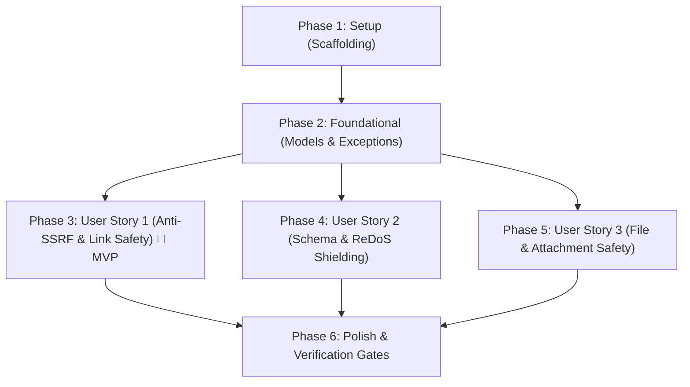

# Tasks: Security, Link & Schema Validation Module

**Input**: Design documents from `specs/001-security-validation-module/`  
**Prerequisites**: [plan.md](plan.md), [spec.md](spec.md), [research.md](research.md), [data-model.md](data-model.md), [endpoints.md](endpoints.md), [test_plan.md](test_plan.md), [use_cases.md](use_cases.md)  
**Tests**: TDD methodology strictly enforced per Constitution v2.4.0 and AGENT.md. Tests are written FIRST and must fail (Red phase) before implementation.  
**Organization**: Tasks are strictly grouped by user story to enable independent implementation and testing of each story.

## Format: `[ID] [P?] [Story] Description with file path`

- **[P]**: Can run in parallel (different files, no blocking dependencies)
- **[Story]**: Which user story this task belongs to (e.g., [US1], [US2], [US3])
- Exact file paths are included in all task descriptions

---

## Phase 1: Setup (Shared Infrastructure)

**Purpose**: Module structure initialization and directory scaffolding per NestJS-style architecture guidelines.

- [ ] T001 Create module directory structure: `src/modules/security/services/`, `tests/unit/modules/security/`, and `tests/integration/modules/security/`
- [ ] T002 [P] Initialize module and test package markers in `src/modules/security/services/__init__.py`, `tests/unit/modules/security/__init__.py`, and `tests/integration/modules/security/__init__.py`

---

## Phase 2: Foundational (Blocking Prerequisites)

**Purpose**: Core domain models and custom exception hierarchy that MUST be completed before ANY user story can be implemented.

**⚠️ CRITICAL**: No user story implementation or test execution can begin until this phase is complete.

- [ ] T003 [P] Implement `SecurityValidationError` hierarchy and standardized error codes in `src/modules/security/exceptions.py`
- [ ] T004 [P] Implement Pydantic domain models (`ValidatedUrl`, `FileValidationResult`, `TemplateSchemaValidationResult`) with `frozen=True` and `extra="forbid"` in `src/modules/security/models.py`
- [ ] T005 Author unit tests for domain models and exception hierarchy in `tests/unit/modules/security/test_models.py`
- [ ] T006 Verify foundational unit tests pass by running `uv run pytest tests/unit/modules/security/test_models.py -v`

**Checkpoint**: Foundation ready — user story implementation can now begin in parallel or sequentially.

---

## Phase 3: User Story 1 - Safe External URL Inspection & Anti-SSRF Defense (Priority: P1) 🎯 MVP

**Goal**: Rigorously inspect, normalize, and verify every external URL before initiating HTTP or headless browser requests, protecting infrastructure against SSRF, internal network scanning, cloud metadata theft, redirect loops, and non-standard port querying.

**Independent Test**: Pass internal IPs (`127.0.0.1`, `10.0.0.1`, `169.254.169.254`), non-standard ports (`22`, `6379`), circular redirects, and educational URLs to `LinkValidatorService`, asserting immediate rejection with standardized error codes or returning canonical `ValidatedUrl` with Chromium DNS pinning rules without dispatching unsafe external requests.

### Tests for User Story 1 (Red Phase) ⚠️
> **NOTE: Write these tests FIRST, ensure they FAIL before implementation**

- [ ] T007 [P] [US1] Author unit tests for RFC 3986 normalization, port/scheme whitelist, path traversal, IDN homograph, and Retry-After in `tests/unit/modules/security/test_link_validator_service.py`
- [ ] T008 [P] [US1] Author integration tests for multi-hop redirect traversal (<= 5 hops) with `httpx.MockTransport` in `tests/integration/modules/security/test_redirect_traversal.py`
- [ ] T009 [P] [US1] Author STRIDE negative security tests for AWS IMDS, loopback, and redirect SSRF pivots in `tests/unit/modules/security/test_security_threats.py`
- [ ] T010 [US1] Verify User Story 1 tests fail in Red Phase by running `uv run pytest tests/unit/modules/security/test_link_validator_service.py tests/integration/modules/security/test_redirect_traversal.py tests/unit/modules/security/test_security_threats.py -v`

### Implementation for User Story 1 (Green Phase)

- [ ] T011 [US1] Implement `LinkValidatorService` RFC 3986 parsing, port/scheme filtering, and path traversal rejection in `src/modules/security/services/link_validator_service.py`
- [ ] T012 [US1] Implement `base_url` relative reference resolution per FR-013 in `src/modules/security/services/link_validator_service.py`
- [ ] T013 [US1] Implement asynchronous DNS resolution, private/reserved CIDR blocking, and Chromium DNS pinning rule generation in `src/modules/security/services/link_validator_service.py`
- [ ] T014 [US1] Implement safe redirect traversal with circular loop detection, max 5-hop cap, and per-hop SSRF re-validation in `src/modules/security/services/link_validator_service.py`
- [ ] T015 [US1] Implement HTTP 429/503 Retry-After header parsing and cooldown evaluation in `src/modules/security/services/link_validator_service.py`
- [ ] T016 [US1] Verify User Story 1 unit and integration tests pass by running `uv run pytest tests/unit/modules/security/test_link_validator_service.py tests/integration/modules/security/test_redirect_traversal.py tests/unit/modules/security/test_security_threats.py -v`

**Checkpoint**: At this point, User Story 1 (MVP) is fully functional and testable independently.

---

## Phase 4: User Story 2 - AI Template Schema & CSS ReDoS Shielding (Priority: P1)

**Goal**: Validate AI-generated extraction schemas and verify CSS selectors against catastrophic backtracking (ReDoS) so corrupt schemas or recursive selectors cannot freeze crawler worker threads.

**Independent Test**: Feed valid schemas, malformed JSON/Pydantic shapes, and pathological backtracking selectors into `SchemaValidatorService`, verifying schema validation and ensuring pathological selectors fail complexity checks or the 200ms dry-run execution timeout.

### Tests for User Story 2 (Red Phase) ⚠️
> **NOTE: Write these tests FIRST, ensure they FAIL before implementation**

- [ ] T017 [P] [US2] Author unit tests for Pydantic schema shape verification and soupsieve compilation in `tests/unit/modules/security/test_schema_validator_service.py`
- [ ] T018 [P] [US2] Author negative security tests for pathological CSS ReDoS backtracking and timeout in `tests/unit/modules/security/test_security_threats.py`
- [ ] T019 [US2] Verify User Story 2 tests fail in Red Phase by running `uv run pytest tests/unit/modules/security/test_schema_validator_service.py -k "test_validate_template_schema" -v`

### Implementation for User Story 2 (Green Phase)

- [ ] T020 [US2] Implement `SchemaValidatorService` Pydantic shape validation and soupsieve selector parsing in `src/modules/security/services/schema_validator_service.py`
- [ ] T021 [US2] Implement CSS selector ReDoS linter (max length 300, max 1 `:has()` depth, max 5 combinators) in `src/modules/security/services/schema_validator_service.py`
- [ ] T022 [US2] Implement dry-run selector execution with 200ms timeout guard in `src/modules/security/services/schema_validator_service.py`
- [ ] T023 [US2] Verify User Story 2 unit tests pass by running `uv run pytest tests/unit/modules/security/test_schema_validator_service.py tests/unit/modules/security/test_security_threats.py -k "schema or redos" -v`

**Checkpoint**: At this point, User Stories 1 AND 2 are both functional and testable independently.

---

## Phase 5: User Story 3 - Downloadable Document & Attachment Verification (Priority: P2)

**Goal**: Verify file size limits, inspect true binary magic bytes, and guard against zip bombs before uploading attachments to AWS S3, rejecting disguised malware, executable scripts, and resource-exhaustion archives.

**Independent Test**: Feed mock file streams containing PDF signatures, disguised PE/ELF headers, high-ratio zip archives, and Content-Disposition headers to `FileValidatorService`, asserting acceptance or rejection based strictly on byte inspections.

### Tests for User Story 3 (Red Phase) ⚠️
> **NOTE: Write these tests FIRST, ensure they FAIL before implementation**

- [ ] T024 [P] [US3] Author unit tests for PDF magic bytes, stream size bounds, and Content-Disposition S3 naming fallback in `tests/unit/modules/security/test_file_validator_service.py`
- [ ] T025 [P] [US3] Author negative security tests for disguised PE/ELF executables and high-ratio zip bomb archives in `tests/unit/modules/security/test_security_threats.py`
- [ ] T026 [US3] Verify User Story 3 tests fail in Red Phase by running `uv run pytest tests/unit/modules/security/test_file_validator_service.py -v`

### Implementation for User Story 3 (Green Phase)

- [ ] T027 [US3] Implement `FileValidatorService` stream size enforcement (25 MB ceiling) and SHA256 checksum in `src/modules/security/services/file_validator_service.py`
- [ ] T028 [US3] Implement pure-Python binary magic byte inspection (PDF, DOCX/XLSX, JPEG, PNG, WEBP) and executable rejection (MZ, ELF, scripts) in `src/modules/security/services/file_validator_service.py`
- [ ] T029 [US3] Implement zip-bomb inspection via `ZipFile.infolist()` (100:1 ratio cap, 50 MB uncompressed cap) in `src/modules/security/services/file_validator_service.py`
- [ ] T030 [US3] Implement S3 key derivation with Content-Disposition header parsing and hash fallback per FR-014 in `src/modules/security/services/file_validator_service.py`
- [ ] T031 [US3] Verify User Story 3 unit tests pass by running `uv run pytest tests/unit/modules/security/test_file_validator_service.py tests/unit/modules/security/test_security_threats.py -k "file or zip or executable" -v`

**Checkpoint**: All three user stories are now independently functional and verified.

---

## Phase 6: Polish & Cross-Cutting Concerns

**Purpose**: Module exports, diagnostic REST route, architectural fitness, static analysis, and security verification suites.

- [ ] T032 [P] Export public services, models, and exceptions in `src/modules/security/__init__.py` and `src/modules/security/services/__init__.py`
- [ ] T033 [P] Implement thin diagnostic inspect-url route in `src/api/routes/v1/security.py` and register in FastAPI router
- [ ] T034 [P] Author diagnostic route tests in `tests/api/routes/v1/test_security_routes.py`
- [ ] T035 Run full test suite with branch coverage reporting: `uv run pytest tests/unit/modules/security/ tests/integration/modules/security/ --cov=src/modules/security --cov-report=term-missing`
- [ ] T036 Run code formatting and linting gates: `uv run ruff check .` and `uv run ruff format --check .`
- [ ] T037 Run ArchUnit architectural tests and layer boundary verification: `uv run pytest tests/architecture/ -v`
- [ ] T038 Run KG-ARCHMAP layer and cycle analysis: `archmap analyze src --fail-on-cycles --fail-on-layer-violations`
- [ ] T039 Run Enola architectural drift check: `enola check . --fail-on=layers,cycles`
- [ ] T040 Run Gitleaks secret scan: `gitleaks detect --source . -v`
- [ ] T041 Run Trivy dependency vulnerability audit: `trivy fs . --scanners vuln --pkg-types library --severity HIGH,CRITICAL --skip-db-update`
- [ ] T042 Run SonarScanner static security and quality gate: `sonar-scanner -Dsonar.projectKey=afaq-ai-service`
- [ ] T043 Execute quickstart validation script and smoke test verification per `specs/001-security-validation-module/quickstart.md`

---

## Dependencies & Execution Order

### Phase Dependencies

- **Setup (Phase 1)**: No dependencies — can start immediately.
- **Foundational (Phase 2)**: Depends on Phase 1 — BLOCKS all user stories.
- **User Stories (Phases 3, 4, 5)**: Depend on Phase 2 completion. Can proceed sequentially in priority order (P1 → P1 → P2) or in parallel across isolated files.
- **Polish & Verification (Phase 6)**: Depends on all user stories being completed.

### Within Each User Story
1. TDD Red phase tests written first.
2. Verify tests fail in Red phase.
3. Implement domain service logic (Green phase).
4. Verify all tests for that story pass.
5. Story complete before proceeding.

### Parallel Opportunities

- **Phase 1 Setup**:
  - `T002` [P] Package markers can be initialized in parallel with directory checks.
- **Phase 2 Foundational**:
  - `T003` [P] (`exceptions.py`) and `T004` [P] (`models.py`) can be implemented in parallel.
- **Phase 3 User Story 1 Tests**:
  - `T007` [P] (`test_link_validator_service.py`), `T008` [P] (`test_redirect_traversal.py`), and `T009` [P] (`test_security_threats.py`) can be authored in parallel.
- **Phase 4 User Story 2 Tests**:
  - `T017` [P] (`test_schema_validator_service.py`) and `T018` [P] (`test_security_threats.py`) can be authored in parallel.
- **Phase 5 User Story 3 Tests**:
  - `T024` [P] (`test_file_validator_service.py`) and `T025` [P] (`test_security_threats.py`) can be authored in parallel.
- **Phase 6 Polish & Verification**:
  - `T032` [P], `T033` [P], `T034` [P] can run in parallel before running unified quality gates (`T035`–`T043`).

---

## Implementation Strategy

### MVP First (User Story 1 Only)
1. Complete Phase 1: Setup (`T001`–`T002`).
2. Complete Phase 2: Foundational (`T003`–`T006`).
3. Complete Phase 3: User Story 1 (`T007`–`T016`).
4. **STOP and VALIDATE**: Verify User Story 1 independently with all unit, integration, and threat tests.
5. Deployable baseline MVP protection for link crawling.

### Incremental Delivery
1. Setup + Foundation complete $\rightarrow$ System core ready.
2. Deliver US1 (Link & Anti-SSRF) $\rightarrow$ Full network isolation guaranteed.
3. Deliver US2 (Schema & ReDoS) $\rightarrow$ AI template extractor safe from parser freezing.
4. Deliver US3 (File & Zip-Bomb) $\rightarrow$ Attachment downloader safe from binaries & decompression bombs.
5. Polish & Verification $\rightarrow$ SonarQube, ArchUnit, Gitleaks, Trivy, and Enola gates green.
