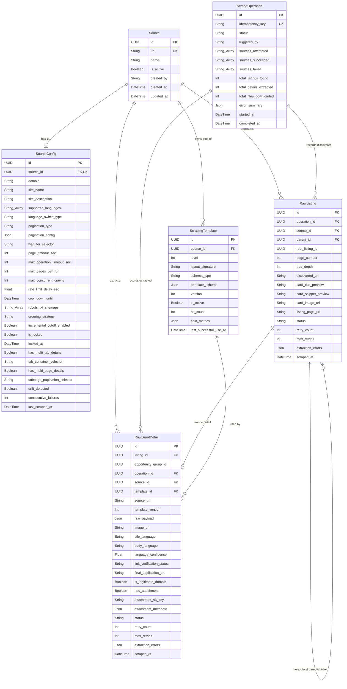
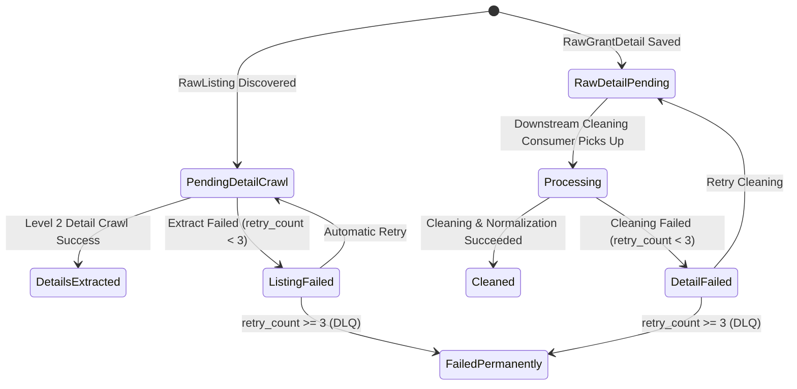

# Data Model: Scraping & Extraction Pipeline

**Feature**: `002-scraping-extraction-pipeline`  
**Created**: 2026-11-05  
**Status**: Ready for Review  

---

## 1. Entity-Relationship Overview

---

## 2. Detailed Entity Specifications

### 2.1. `Source` (Administrative URL Registry)
* **Table**: `sources`
* **Purpose**: Clean, minimal registry for administrators to register target portals.
* **Fields**:
  * `id`: `UUID` (Primary Key, auto-generated).
  * `url`: `String` (Unique, target entry-point URL e.g. `https://almin7.com/scholarships/`).
  * `name`: `String?` (Human-friendly label; auto-generated during Stage 0 if omitted).
  * `is_active`: `Boolean` (Default `true`. Master administrative kill-switch).
  * `created_by`: `String?` (Admin user identifier).
  * `created_at`: `DateTime` (Default `now()`).
  * `updated_at`: `DateTime` (Updated automatically on mutation).

---

### 2.2. `SourceConfig` (Technical Crawling & Discovery Settings)
* **Table**: `source_configs`
* **Purpose**: Populated autonomously during Stage 0 discovery; maintains runtime crawler parameters, health metrics, and concurrency locks.
* **Fields & Constraints**:
  * `id`: `UUID` (Primary Key).
  * `source_id`: `UUID` (Foreign Key $\rightarrow$ `sources.id`, Unique 1-to-1).
  * `domain`: `String` (Normalized hostname e.g. `almin7.com`).
  * `site_name`: `String` (AI-discovered portal title).
  * `site_description`: `String?` (AI-generated summary).
  * `supported_languages`: `String[]` (Discovered languages e.g. `["ar", "en"]`).
  * `language_switch_type`: `String?` (`hreflang`, `url_prefix`, `cookie`, `none`).
  * `pagination_type`: `String` (`next_button`, `url_param`, `infinite_scroll`, `none`).
  * `pagination_config`: `Json` (Specific parameters e.g. `{"param": "page", "step": 1, "page_size_param": "limit"}`).
  * `wait_for_selector`: `String?` (Target element selector for page-load readiness).
  * `page_timeout_sec`: `Int` (Default: 30 seconds).
  * `max_operation_timeout_sec`: `Int` (Default: 1200 seconds / 20 minutes).
  * `max_pages_per_run`: `Int` (Default: 10 pages).
  * `max_concurrent_crawls`: `Int` (Default: 1 for bounded RAM footprint).
  * `rate_limit_delay_sec`: `Float` (Default: 1.0; populated from `robots.txt` if specified).
  * `cool_down_until`: `DateTime?` (Populated upon HTTP 429/503 `Retry-After`; skips until expired).
  * `robots_txt_sitemaps`: `String[]` (Discovered XML sitemaps).
  * `ordering_strategy`: `String` (`chronological_descending`, `deadline_ascending`, `featured_sponsored_mixed`, `unknown`).
  * `incremental_cutoff_enabled`: `Boolean` (Default `true`; auto-disabled if non-chronological).
  * `is_locked`: `Boolean` (Default `false`; atomic distributed lock).
  * `locked_at`: `DateTime?` (Lock acquisition timestamp; auto-expires after 30 minutes).
  * `has_multi_tab_details`: `Boolean` (Default `false`).
  * `tab_container_selector`: `String?` (Selector for unhiding tabs e.g. `.nav-tabs a`).
  * `has_multi_page_details`: `Boolean` (Default `false`).
  * `subpage_pagination_selector`: `String?` (Selector for in-article sub-pages).
  * `drift_detected`: `Boolean` (Default `false`; flagged when fill-rate collapses).
  * `consecutive_failures`: `Int` (Default: 0; increments on errors, resets on successful extraction).
  * `last_scraped_at`: `DateTime?`

---

### 2.3. `ScrapingTemplate` (Multi-Template Historical Pool)
* **Table**: `scraping_templates`
* **Purpose**: Maintains active and historical extraction schemas per source to handle layout rotation without LLM invocations.
* **Fields & Constraints**:
  * `id`: `UUID` (Primary Key).
  * `source_id`: `UUID` (Foreign Key $\rightarrow$ `sources.id`).
  * `level`: `Int` (`1` = Catalog/Listing, `2` = Detail Page).
  * `layout_signature`: `String` (Structural DOM signature / fingerprint).
  * `schema_type`: `String` (Default `"CSS"`).
  * `template_schema`: `Json` (Declarative schema compatible with `JsonCssExtractionStrategy`).
  * `version`: `Int` (Incremental minor version e.g. 1, 2, 3).
  * `is_active`: `Boolean` (Default `true`; included in active matching candidate pool).
  * `hit_count`: `Int` (Default 0; incremented on successful application).
  * `field_metrics`: `Json?` (Rolling field fill-rates e.g. `{"title": 1.0, "deadline": 0.95}`).
  * `last_successful_use_at`: `DateTime?`
  * **Constraint**: `UNIQUE (source_id, level, version)`.

---

### 2.4. `ScrapeOperation` (Batch Telemetry & Job Reports)
* **Table**: `scrape_operations`
* **Purpose**: Audit trails and operational reporting for every batch crawl execution.
* **Fields**:
  * `id`: `UUID` (Primary Key, the `operation_id`).
  * `idempotency_key`: `String?` (Unique; optional UUID to deduplicate requests within 15 minutes).
  * `status`: `String` (`running`, `completed`, `failed`, `partial`, `timed_out`, `aborted`).
  * `triggered_by`: `String` (`cron`, `admin_api`, `manual_retry`).
  * `sources_attempted`: `String[]` (UUIDs of candidate sources).
  * `sources_succeeded`: `String[]` (UUIDs of successfully scraped sources).
  * `sources_failed`: `String[]` (UUIDs of failed sources).
  * `total_listings_found`: `Int` (Level 1 discovered cards count).
  * `total_details_extracted`: `Int` (Level 2 extracted opportunities count).
  * `total_files_downloaded`: `Int` (Attachments uploaded to S3 count).
  * `error_summary`: `Json` (Error breakdown and failure codes per source).
  * `started_at`: `DateTime` (Default `now()`).
  * `completed_at`: `DateTime?`

---

### 2.5. `RawListing` (Level 1 Discovered Cards & Multi-Page Tree)
* **Table**: `raw_listings`
* **Purpose**: Captures discovered opportunity card snippets from catalog pages and tracks multi-page article hierarchies.
* **Fields & Constraints**:
  * `id`: `UUID` (Primary Key).
  * `operation_id`: `UUID` (Foreign Key $\rightarrow$ `scrape_operations.id`).
  * `source_id`: `UUID` (Foreign Key $\rightarrow$ `sources.id`).
  * `parent_id`: `UUID?` (Self-referencing Foreign Key for multi-page sub-articles).
  * `root_listing_id`: `UUID?` (Root listing node in multi-page article tree).
  * `page_number`: `Int` (Default: 1).
  * `tree_depth`: `Int` (Default: 0; capped at $\le 4$ / max 5 pages).
  * `discovered_url`: `String` (Direct URL to the opportunity detail page).
  * `card_title_preview`: `String?` (Card preview title).
  * `card_snippet_preview`: `String?` (Card description snippet).
  * `card_image_url`: `String?` (Card thumbnail image URL).
  * `listing_page_url`: `String` (Paginated catalog URL where card was found).
  * `status`: `String` (`pending_detail_crawl`, `details_extracted`, `failed`, `failed_permanently`).
  * `retry_count`: `Int` (Default: 0).
  * `max_retries`: `Int` (Default: 3).
  * `extraction_errors`: `Json?` (Audit logs and stack traces on failure).
  * `scraped_at`: `DateTime` (Default `now()`).
  * **Constraint**: `UNIQUE (source_id, discovered_url)`.

---

### 2.6. `RawGrantDetail` (Level 2 Comprehensive Raw Extraction)
* **Table**: `raw_grant_details`
* **Purpose**: Stores complete, unmutated scholarship attributes, bilingual pairing links, and S3 attachment metadata.
* **Fields & Constraints**:
  * `id`: `UUID` (Primary Key).
  * `listing_id`: `UUID?` (Foreign Key $\rightarrow$ `raw_listings.id`).
  * `opportunity_group_id`: `UUID?` (Shared UUID linking native Arabic and English versions of the same opportunity).
  * `operation_id`: `UUID` (Foreign Key $\rightarrow$ `scrape_operations.id`).
  * `source_id`: `UUID` (Foreign Key $\rightarrow$ `sources.id`).
  * `template_id`: `UUID?` (Foreign Key $\rightarrow$ `scraping_templates.id`).
  * `source_url`: `String` (Detail page URL).
  * `template_version`: `Int` (Version number of template used).
  * `raw_payload`: `Json` (Structured raw attributes: title, university, funding, stipend, deadline, eligibility).
  * `image_url`: `String?` (Hero image URL).
  * `title_language`: `String` (ISO 639-1 code e.g. `"ar"`, `"en"`, or `"und"`).
  * `body_language`: `String` (ISO 639-1 code e.g. `"ar"`, `"en"`, or `"und"`).
  * `language_confidence`: `Float` (Statistical model confidence, 0.0 to 1.0; $<0.50$ tags as `"und"`).
  * `link_verification_status`: `String` (`verified`, `suspicious`, `unreachable`, `s3_download`).
  * `final_application_url`: `String?` (Resolved destination URL after following redirects).
  * `is_legitimate_domain`: `Boolean?`
  * `has_attachment`: `Boolean` (Default `false`).
  * `attachment_s3_key`: `String?` (`s3://bucket/attachments/{source_id}/{sha256}.pdf`).
  * `attachment_metadata`: `Json?` (File size, mime-type, SHA256 checksum).
  * `status`: `String` (`pending`, `processing`, `cleaned`, `failed`, `failed_permanently`).
  * `retry_count`: `Int` (Default: 0).
  * `max_retries`: `Int` (Default: 3).
  * `extraction_errors`: `Json?`
  * `error_message`: `String?`
  * `scraped_at`: `DateTime` (Default `now()`).

---

## 3. Entity State Lifecycles & Dead Letter Queue (DLQ)

### Dead Letter Queue Invariants:
1. When an extraction failure occurs, `retry_count` is incremented and the error detail is recorded in `extraction_errors`.
2. As long as `retry_count < max_retries` (default 3), the status is set to `failed` and remains eligible for subsequent retry attempts.
3. Once `retry_count >= max_retries`, the record transitions to `failed_permanently`. It will no longer be picked up by automated runs, remaining isolated for inspection via the administrative dead-letter query endpoint (`GET /api/v1/scrape/dead-letter`).
