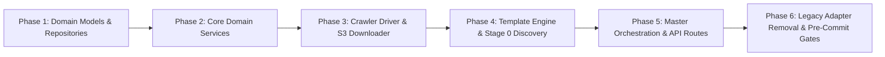

# Implementation Plan: Autonomous Crawl4AI Multi-Level Scraping & Raw Extraction Pipeline

**Branch**: `feat/crawl4ai-adaptive-scraping` | **Date**: 2026-11-05 | **Spec**: [spec.md](spec.md)

**Input**: Feature specification from [`specs/002-scraping-extraction-pipeline/spec.md`](spec.md) and architectural reports in [`docs/reports/scraping_extraction_pipeline/`](../../docs/reports/scraping_extraction_pipeline/).

---

## 1. Summary

Build the redesigned, fully autonomous **Data Extraction Engine** (`src/modules/scraping/`) for `Afaq-AI-Service`. Replaces all legacy hardcoded adapters with a unified browser-driven crawling engine powered by Crawl4AI / Playwright, multi-template historical pools, self-healing micro-repairs, bilingual dual-crawl pairing, and secure document streaming to AWS S3. 

The pipeline operates under a strict **single-browser sequential concurrency model** (`max_concurrent_crawls = 1`) to preserve memory within the strict 1 GB server RAM boundary, executes in two sequential phases per source (catalog discovery first, detail extraction second), and prioritizes sources dynamically based on administrative tier, staleness, and health.

---

## 2. Technical Context

* **Language/Version**: Python 3.12+ (runtime managed with `uv`).
* **Primary Dependencies**:
  * `crawl4ai` & `playwright` (headless browser automation and stealth rendering).
  * `pydantic` v2 (declarative extraction contracts with `strict=True`, `extra="forbid"`).
  * `py3langid` (fast, offline statistical n-gram language classification).
  * `soupsieve` (CSS selector AST parsing and complexity linting).
  * `httpx` (asynchronous pre-flight reachability checks).
  * `boto3` / `aioboto3` (AWS S3 streaming uploads).
  * `prisma-client-py` (database persistence and repository operations).
  * Internal: `src/modules/security/` (`LinkValidatorService`, `FileValidatorService`, `SchemaValidatorService`).
* **Storage**:
  * **Database**: PostgreSQL managed via Prisma (`sources`, `source_configs`, `scraping_templates`, `scrape_operations`, `raw_listings`, `raw_grant_details`).
  * **Object Storage**: AWS S3 (`s3://{BUCKET}/attachments/{source_id}/{sha256}.pdf`) for downloadable forms and guidelines.
* **Testing**: `pytest`, `pytest-asyncio`, `pytest-cov`, `archunitpython`, `enola`, `kg-archmap`.
* **Target Platform**: Linux server / Docker container (single-process concurrency, RAM $\le 1$ GB).
* **Project Type**: Web service / background asynchronous worker (modular monolith).
* **Performance Goals & Benchmark Boundary**:
  * Single-process Chromium RAM maintained strictly within **300 MB–450 MB** via per-page browser context disposal and memory-pruning flags.
  * Selector dry-run evaluation gate strictly bound by a 200 ms timeout.
  * System throughput and latency benchmarks are directional targets benchmarked **exclusively via user-configured k6 load test suites**.
  * **Constitution Principle VI & AGENT.md Compliance**: Automated functional, unit, and integration test suites **MUST NEVER** assert, expect, or enforce execution duration limits or latency SLAs.
* **Constraints**:
  * Bounded memory footprint strictly under 1 GB total server RAM.
  * Public educational data only; zero paywall bypass or CAPTCHA solving.
  * All external URLs and downloaded files must traverse the security gateway before processing.
  * Two-phase sequential execution (catalog first, details second) to ensure zero lost listings upon restart.
  * Ad-hoc `max_pages` overrides omitted; crawl depth strictly read from database `source_configs.max_pages_per_run`.

---

## 3. Constitution Check

*GATE: Must pass before Phase 0 research. Re-check after Phase 1 design.*

* **Public Data Only & Zero Paywall Bypass:** **PASS** — Enforces public educational opportunity extraction; bot challenges halt with `ERR_ACCESS_CHALLENGE_BLOCKED` and cooldown backoff without attempting bypass.
* **Zero-Trust Gatekeeper Inspection:** **PASS** — Every external URL, redirected hop, and file stream traverses `src/modules/security/` validators before browser navigation or S3 persistence.
* **Single-Browser Low-Memory Bound:** **PASS** — Implements `max_concurrent_crawls = 1`, custom Chromium memory-pruning flags, and per-page context disposal keeping browser RAM pegged under 450 MB ($\le 1$ GB server total).
* **Raw vs. Cleaning Separation:** **PASS** — Raw extraction stores unmutated publisher text in `raw_grant_details`; cross-source deduplication, taxonomy mapping, and canonical merging are strictly deferred to `src/modules/cleaning/`.
* **Zero Test Execution Time Assertions:** **PASS** — Test plan explicitly excludes execution duration thresholds and timeout SLAs; performance evaluation is restricted to user-configured k6 scripts.
* **Mandatory Service Architecture & Test Separation Pattern:** **PASS** — All business logic resides in `src/modules/scraping/services/*_service.py`; tests are partitioned into `tests/unit/modules/scraping/` and `tests/integration/modules/scraping/`.

---

## 4. Project Structure

### Documentation & Planning Artifacts
```text
specs/002-scraping-extraction-pipeline/
├── spec.md               # Functional requirements & user stories (completed)
├── checklists/
│   └── requirements.md   # Quality validation checklist (16/16 passed)
├── research.md           # Phase 0 architectural & technical decisions (completed)
├── data-model.md         # Phase 1 domain entities, relationships & DLQ lifecycles (completed)
├── endpoints.md          # Phase 1 REST API contracts & webhook specifications (completed)
├── use_cases.md          # Phase 1 17 primary, edge, and failure scenarios (completed)
├── security.md           # Phase 1 STRIDE threat model & negative test specifications (completed)
├── quickstart.md         # Phase 1 runnable validation guide & manual probe commands (completed)
├── plan.md               # This phased technical implementation blueprint
├── test_plan.md          # Phase 1 TDD test specifications (linked 1-to-1 to use cases)
├── tasks.md              # Phase 2 output (/speckit-tasks command)
└── review_priorities.md  # Phase 2 output (/speckit-tasks command)
```

### Source Code Layout
```text
src/
└── modules/
    └── scraping/
        ├── __init__.py                         # Public facade exports (services, protocols, exceptions)
        ├── models.py                           # Pydantic schemas (ExtractionResult, JobStatus, etc.)
        ├── exceptions.py                       # Typed domain exceptions (ScrapingError hierarchy)
        └── services/
            ├── __init__.py                     # Service exports
            ├── scraper_service.py              # Master orchestrator (Phase 1 Catalog -> Phase 2 Details)
            ├── discovery_service.py            # Stage 0 zero-config mapping & DOM skeletonization
            ├── crawler_service.py              # Crawl4AI driver with memory pruning & DNS pinning
            ├── template_engine_service.py      # 3-gate template matching, synthesis & micro-repair
            ├── pagination_service.py           # Catalog traversal, 5 termination signals & lookahead
            ├── prioritization_service.py       # Dynamic score calculation & domain interleaving
            ├── language_classifier_service.py   # Statistical n-gram language analysis (py3langid)
            └── document_ingestion_service.py   # PDF streaming, magic-byte checks & S3 cache reuse

src/api/routes/v1/
└── scrape.py                                   # FastAPI route controller (POST /run, GET /operations, etc.)

tests/unit/modules/scraping/
├── __init__.py
├── test_models.py                              # Pydantic validation & value object tests
├── test_prioritization_service.py              # Priority scoring & domain interleaving tests
├── test_language_classifier_service.py         # Statistical n-gram language classification tests
├── test_template_engine_service.py             # 3-gate matching, fill-rate metrics & micro-repair tests
└── test_pagination_service.py                  # Pagination rules, termination signals & lookahead tests

tests/integration/modules/scraping/
├── __init__.py
├── test_batch_scrape_orchestration.py          # End-to-end two-phase crawl with MockTransport
├── test_stage_0_discovery.py                   # Stage 0 onboarding & DOM pruning integration
└── test_dead_letter_queue.py                   # DLQ threshold and retry transition tests
```

---

## 5. Phased Implementation Roadmap



### Phase 1: Domain Models, Repositories & Protocols
* Instantiate Pydantic request/response models in `src/modules/scraping/models.py`.
* Define typed domain exceptions in `src/modules/scraping/exceptions.py`.
* Implement repository layer methods for `SourceConfig`, `ScrapingTemplate`, `RawListing`, `RawGrantDetail`, and `ScrapeOperation` in `src/modules/core/database/repositories/`.

### Phase 2: Core Domain Services
* Implement `PrioritizationService`: Dynamic score calculation and domain interleaving.
* Implement `LanguageClassifierService`: Sub-millisecond n-gram language classification with `<0.50` threshold.
* Implement `PaginationService`: Dynamic pagination handling and the 5 termination signals.

### Phase 3: Crawl4AI Driver & S3 Document Downloader
* Implement `CrawlerService`: Crawl4AI headless Chromium lifecycle manager with memory pruning flags (`--disable-dev-shm-usage`, `--no-zygote`), per-page context disposal, and Chromium DNS pinning.
* Implement `DocumentIngestionService`: S3 document streaming with 25 MB ceiling, magic-byte verification, zip-bomb protection, and S3 metadata cache reuse.

### Phase 4: Template Engine & Stage 0 Discovery
* Implement `TemplateEngineService`: 3-gate deterministic matching, rolling fill-rate tracking, soft-drift micro-repair (`v1.0` $\rightarrow$ `v1.1`), and 4-stage validation pipeline for newly synthesized schemas.
* Implement `DiscoveryService`: Stage 0 pre-flight network checks, `robots.txt` parsing, DOM skeletonization (compressing 1.5 MB to 3–8 KB), and AI relevance verification.

### Phase 5: Master Orchestrator & API Route Transport
* Implement `ScraperService`: Master coordinator enforcing sequential two-phase execution per source (Phase 1 Catalog $\rightarrow$ Phase 2 Details), atomic distributed locking, 20-minute hard timeouts, graceful cancellation signals, and webhook dispatching.
* Build thin FastAPI route controller in `src/api/routes/v1/scrape.py` implementing:
  * `POST /api/v1/scrape/run` (Non-blocking 202 Accepted, Idempotency-Key check).
  * `GET /api/v1/scrape/operations` (Paginated operations history & status filter).
  * `GET /api/v1/scrape/operations/latest` (Current running or most recent operation).
  * `GET /api/v1/scrape/operations/{id}` (Operation status & telemetry details).
  * `POST /api/v1/scrape/operations/{id}/abort` (Graceful cancellation of active operation & lock release).
  * `POST /api/v1/scrape/sources/{id}/abort` (Selective halting of a specific target source).
  * `POST /api/v1/scrape/sources/onboard` (Stage 0 Discovery trigger).
  * `GET /api/v1/scrape/dead-letter` (Dead Letter Queue inspection).

### Phase 6: Legacy Adapter Decommissioning & Pre-Commit Quality Verification
* Safely delete all legacy scraper adapters (`Almin7Adapter`, `GrabScholarshipAdapter`, `Scholars4DevAdapter`, `WordPressApiAdapter`, `AdapterFactory`, `BaseAdapter`).
* Run full pre-commit verification pipeline: Ruff, Black, Pytest unit/integration suites, ArchUnit invariant tests, KG-ARCHMAP, Enola, Pact broker contract verification, Gitleaks, and Trivy scans.
