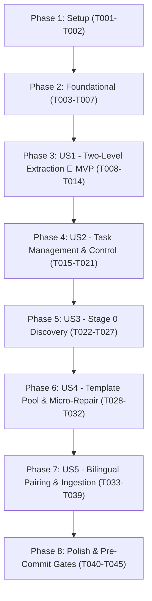

# Tasks: Autonomous Crawl4AI Multi-Level Scraping & Raw Extraction Pipeline

**Input**: Design documents from `specs/002-scraping-extraction-pipeline/`  
**Prerequisites**: [plan.md](plan.md), [spec.md](spec.md), [research.md](research.md), [data-model.md](data-model.md), [endpoints.md](endpoints.md), [use_cases.md](use_cases.md), [security.md](security.md), [test_plan.md](test_plan.md), [quickstart.md](quickstart.md)  
**Tests**: TDD methodology strictly enforced per Constitution v2.4.0 and AGENT.md. Tests are written FIRST and must fail (Red phase) before implementation.  
**Organization**: Tasks are strictly grouped by user story to enable independent implementation and testing of each story.

## Format: `[ID] [P?] [Story] Description with file path`

- **[P]**: Can run in parallel (different files, no blocking dependencies)
- **[Story]**: Which user story this task belongs to (e.g., [US1], [US2], [US3], [US4], [US5])
- Exact file paths are included in all task descriptions

---

## Phase 1: Setup (Shared Infrastructure)

**Purpose**: Module structure initialization and directory scaffolding per NestJS-style architecture guidelines.

- [ ] T001 Create module directory structure: `src/modules/scraping/services/`, `tests/unit/modules/scraping/`, and `tests/integration/modules/scraping/`
- [ ] T002 [P] Initialize module and test package markers in `src/modules/scraping/services/__init__.py`, `tests/unit/modules/scraping/__init__.py`, and `tests/integration/modules/scraping/__init__.py`

---

## Phase 2: Foundational (Blocking Prerequisites)

**Purpose**: Core domain models, custom exception hierarchy, and database repository layer that MUST be completed before ANY user story can be implemented.

**⚠️ CRITICAL**: No user story implementation or test execution can begin until this phase is complete.

- [ ] T003 [P] Implement `ScrapingError` hierarchy and standardized domain error codes (`ERR_NOT_OPPORTUNITY_PORTAL`, `ERR_ACCESS_CHALLENGE_BLOCKED`, `ERR_RATE_LIMITED_COOLDOWN`, `ERR_OPERATION_TIMEOUT`, `ERR_CSS_SELECTOR_REDOS_TIMEOUT`) in `src/modules/scraping/exceptions.py`
- [ ] T004 [P] Implement Pydantic domain models (`ScrapeRunRequest`, `ScrapeOperationResponse` with typed `error_summary: dict[str, Any] = {}` for partial abort metadata, `ExtractionResult`, `SourceOnboardRequest`, `SourceOnboardResponse`) in `src/modules/scraping/models.py`
- [ ] T005 [P] Implement repository data access methods for `SourceConfig`, `ScrapingTemplate`, `RawListing`, `RawGrantDetail`, and `ScrapeOperation` in `src/modules/core/database/repositories/scraping_repository.py`
- [ ] T006 Author foundational unit tests for domain models and exception hierarchy in `tests/unit/modules/scraping/test_models.py`
- [ ] T007 Verify foundational unit tests pass by running `uv run pytest tests/unit/modules/scraping/test_models.py -v`

**Checkpoint**: Foundation ready — user story implementation can now begin in parallel or sequentially.

---

## Phase 3: User Story 1 - Two-Level Specialized Template Extraction (Priority: P1) 🎯 MVP

**Goal**: Execute distinct Level 1 (catalog) and Level 2 (detail) page extraction workflows using specialized templates tailored to each page type, handling catalog pagination, multi-tab unhiding, and multi-page article tree hierarchies.

**Independent Test**: Feed a catalog listing HTML document to `PaginationService` and verify card links and pagination controls (TEST-06, TEST-07); feed detail HTML to `CrawlerService` and verify attribute extraction, multi-tab unhiding, and multi-page tree recursion capping (TEST-08, TEST-09).

### Tests for User Story 1 (Red Phase) ⚠️
> **NOTE: Write these tests FIRST, ensure they FAIL before implementation**

- [ ] T008 [P] [US1] Author unit tests for pagination mechanisms (query, path, next button), the 5 termination signals, and 2-page lookahead cutoff in `tests/unit/modules/scraping/test_pagination_service.py`
- [ ] T009 [P] [US1] Author unit tests for multi-tab unhiding and multi-page article tree lineage & 5-page depth cap in `tests/unit/modules/scraping/test_crawler_service.py`
- [ ] T010 [US1] Verify User Story 1 tests fail in Red Phase by running `uv run pytest tests/unit/modules/scraping/test_pagination_service.py tests/unit/modules/scraping/test_crawler_service.py -v`

### Implementation for User Story 1 (Green Phase)

- [ ] T011 [US1] Implement `PaginationService` dynamic URL pagination, SHA256 card fingerprint loop detection, and 2-page lookahead cutoff in `src/modules/scraping/services/pagination_service.py`
- [ ] T012 [US1] Implement `CrawlerService` Crawl4AI / Playwright browser lifecycle manager with Chromium memory-pruning flags (`--disable-dev-shm-usage`, `--no-zygote`, `--disable-gpu`) and Chromium DNS pinning via `LinkValidatorService` in `src/modules/scraping/services/crawler_service.py`
- [ ] T013 [US1] Implement client-side JavaScript multi-tab unhiding (`.tab-pane`, `[role="tabpanel"]`) and multi-page article virtual DOM concatenation with 5-page cap in `src/modules/scraping/services/crawler_service.py`
- [ ] T014 [US1] Verify User Story 1 unit tests pass by running `uv run pytest tests/unit/modules/scraping/test_pagination_service.py tests/unit/modules/scraping/test_crawler_service.py -v`

**Checkpoint**: At this point, User Story 1 (MVP) is fully functional and testable independently.

---

## Phase 4: User Story 2 - Task Management, Prioritization & Operational Control (Priority: P2)

**Goal**: Trigger scraping runs asynchronously with non-blocking `202 Accepted` and `Idempotency-Key` deduplication, manage active runs with atomic per-source locking, prioritize sources dynamically, query operations history and latest runs, and gracefully abort operations or single sources.

**Independent Test**: Submit concurrent scraping trigger requests, verifying non-blocking 202 responses with `operation_id`, verifying that already-locked sources are skipped safely, testing priority score ordering, and validating `GET /operations`, `GET /operations/latest`, `POST /operations/{id}/abort`, and `POST /sources/{id}/abort` (TEST-11, TEST-14, TEST-15, TEST-18, TEST-19, TEST-20).

### Tests for User Story 2 (Red Phase) ⚠️
> **NOTE: Write these tests FIRST, ensure they FAIL before implementation**

- [ ] T015 [P] [US2] Author unit tests for dynamic priority scoring formula and domain interleaving in `tests/unit/modules/scraping/test_prioritization_service.py`
- [ ] T016 [P] [US2] Author integration tests for operation lifecycle, idempotency key deduplication, 20-min hard timeout, lock recovery, and graceful abort endpoints in `tests/integration/modules/scraping/test_batch_scrape_orchestration.py`
- [ ] T017 [US2] Verify User Story 2 tests fail in Red Phase by running `uv run pytest tests/unit/modules/scraping/test_prioritization_service.py tests/integration/modules/scraping/test_batch_scrape_orchestration.py -v`

### Implementation for User Story 2 (Green Phase)

- [ ] T018 [US2] Implement `PrioritizationService` multi-source scoring formula and domain interleaving logic in `src/modules/scraping/services/prioritization_service.py`
- [ ] T019 [US2] Implement `ScraperService` master coordinator enforcing sequential two-phase execution per source (Phase 1 Catalog $\rightarrow$ Phase 2 Details), atomic locking, cancellation tokens, and 20-min timeout ceiling in `src/modules/scraping/services/scraper_service.py`
- [ ] T020 [US2] Implement FastAPI route controller in `src/api/routes/v1/scrape.py` handling `POST /run`, `GET /operations`, `GET /operations/latest`, `GET /operations/{id}`, `POST /operations/{id}/abort`, and `POST /sources/{id}/abort`
- [ ] T021 [US2] Verify User Story 2 unit and integration tests pass by running `uv run pytest tests/unit/modules/scraping/test_prioritization_service.py tests/integration/modules/scraping/test_batch_scrape_orchestration.py -v`

**Checkpoint**: At this point, User Stories 1 AND 2 are both functional and testable independently.

---

## Phase 5: User Story 3 - Stage 0 Zero-Configuration Source Onboarding (Priority: P3)

**Goal**: Onboard new educational portals simply by registering their entry URL, autonomously conducting pre-flight security checks, DOM skeletonization, relevance validation, and technical configuration creation in `source_configs`.

**Independent Test**: Submit entry URLs of valid scholarship portals, commercial e-commerce websites, and unreachable domains, confirming automated population of `source_configs` for valid portals and immediate rejection (`ERR_NOT_OPPORTUNITY_PORTAL`) for invalid targets (TEST-02).

### Tests for User Story 3 (Red Phase) ⚠️
> **NOTE: Write these tests FIRST, ensure they FAIL before implementation**

- [ ] T022 [P] [US3] Author integration tests for Stage 0 pre-flight checks, `robots.txt` parsing, DOM pruning, prompt sandbox isolation, and conditional 2nd-hop crawl in `tests/integration/modules/scraping/test_stage_0_discovery.py`
- [ ] T023 [US3] Verify User Story 3 tests fail in Red Phase by running `uv run pytest tests/integration/modules/scraping/test_stage_0_discovery.py -v`

### Implementation for User Story 3 (Green Phase)

- [ ] T024 [US3] Implement DOM skeletonization (collapsing cards, stripping noise down to 3–8 KB) and XML prompt sandbox packaging (`<untrusted_web_content>`) in `src/modules/scraping/services/discovery_service.py`
- [ ] T025 [US3] Implement AI platform mapping (Gemini Flash integration), relevance gate (`ERR_NOT_OPPORTUNITY_PORTAL`), and conditional 2nd-hop catalog crawl in `src/modules/scraping/services/discovery_service.py`
- [ ] T026 [US3] Wire `POST /api/v1/scrape/sources/onboard` route handler in `src/api/routes/v1/scrape.py` delegating to `DiscoveryService`
- [ ] T027 [US3] Verify User Story 3 integration tests pass by running `uv run pytest tests/integration/modules/scraping/test_stage_0_discovery.py -v`

**Checkpoint**: At this point, User Stories 1, 2, AND 3 are functional and testable independently.

---

## Phase 6: User Story 4 - Multi-Template Pool & Self-Healing Micro-Repairs (Priority: P4)

**Goal**: Match incoming pages against a historical pool of templates using a 3-gate deterministic test (zero AI cost), track rolling field fill-rate degradation, and repair soft drift autonomously with ~300 token Micro-Repairs (`v1.0` $\rightarrow$ `v1.1`).

**Independent Test**: Evaluate cached templates against mock DOMs, verifying fast deterministic matching with 0 AI calls, tracking rolling fill-rate degradation in `field_metrics`, and verifying targeted micro-repair on degraded selectors (TEST-03, TEST-10).

### Tests for User Story 4 (Red Phase) ⚠️
> **NOTE: Write these tests FIRST, ensure they FAIL before implementation**

- [ ] T028 [P] [US4] Author unit tests for 3-gate deterministic matching, rolling fill-rate metrics, soft-drift micro-repair, and 4-stage validation pipeline in `tests/unit/modules/scraping/test_template_engine_service.py`
- [ ] T029 [US4] Verify User Story 4 tests fail in Red Phase by running `uv run pytest tests/unit/modules/scraping/test_template_engine_service.py -v`

### Implementation for User Story 4 (Green Phase)

- [ ] T030 [US4] Implement 3-gate deterministic evaluation (container check, coverage threshold, text bounds) and rolling fill-rate updates in `src/modules/scraping/services/template_engine_service.py`
- [ ] T031 [US4] Implement soft-drift detection ($>40\%$ drop), targeted Micro-Repair prompting (`v1.0` $\rightarrow$ `v1.1`), and 4-stage validation pipeline via `SchemaValidatorService` in `src/modules/scraping/services/template_engine_service.py`
- [ ] T032 [US4] Verify User Story 4 unit tests pass by running `uv run pytest tests/unit/modules/scraping/test_template_engine_service.py -v`

**Checkpoint**: At this point, User Stories 1, 2, 3, AND 4 are functional and testable independently.

---

## Phase 7: User Story 5 - Bilingual Pairing, Document Ingestion & Dead Letter Queue (Priority: P5)

**Goal**: Capture native Arabic and English versions of opportunities under a shared `opportunity_group_id`, classify text languages with sub-millisecond n-gram analysis, stream application PDFs to S3 with cache reuse, and dead-letter failed extractions after 3 retries.

**Independent Test**: Scrape paired Arabic/English URLs asserting shared `opportunity_group_id` (TEST-04), verify n-gram language classification and `<0.50` threshold, test S3 attachment streaming and cache reuse (TEST-05, TEST-16), and assert DLQ transitions for records exceeding 3 retries (TEST-17).

### Tests for User Story 5 (Red Phase) ⚠️
> **NOTE: Write these tests FIRST, ensure they FAIL before implementation**

- [ ] T033 [P] [US5] Author unit tests for statistical n-gram language classification and independent title/body language detection in `tests/unit/modules/scraping/test_language_classifier_service.py`
- [ ] T034 [P] [US5] Author integration tests for S3 stream downloading, attachment cache reuse, bilingual `opportunity_group_id` linking, and DLQ state transitions in `tests/integration/modules/scraping/test_dead_letter_queue.py`
- [ ] T035 [US5] Verify User Story 5 tests fail in Red Phase by running `uv run pytest tests/unit/modules/scraping/test_language_classifier_service.py tests/integration/modules/scraping/test_dead_letter_queue.py -v`

### Implementation for User Story 5 (Green Phase)

- [ ] T036 [US5] Implement `LanguageClassifierService` offline statistical n-gram analysis (`py3langid`) with `<0.50` confidence threshold in `src/modules/scraping/services/language_classifier_service.py`
- [ ] T037 [US5] Implement `DocumentIngestionService` S3 streaming, attachment URL cache check, magic-byte inspection, and zip-bomb rejection via `FileValidatorService` in `src/modules/scraping/services/document_ingestion_service.py`
- [ ] T038 [US5] Implement native bilingual pairing (`opportunity_group_id`), DLQ retry threshold transitions, and `GET /api/v1/scrape/dead-letter` route in `src/modules/scraping/services/scraper_service.py` and `src/api/routes/v1/scrape.py`
- [ ] T039 [US5] Verify User Story 5 unit and integration tests pass by running `uv run pytest tests/unit/modules/scraping/test_language_classifier_service.py tests/integration/modules/scraping/test_dead_letter_queue.py -v`

**Checkpoint**: All 5 User Stories are fully implemented and verified independently.

---

## Phase 8: Polish, Legacy Decommissioning & Pre-Commit Verification

**Purpose**: Safely remove legacy adapters, export public module facades, verify architectural invariants, and pass all pre-commit quality gates.

- [ ] T040 Decommission and delete all legacy hardcoded scraper adapters: `src/modules/scraping/adapters/almin7_adapter.py`, `src/modules/scraping/adapters/grabscholarship_adapter.py`, `src/modules/scraping/adapters/scholars4dev_adapter.py`, `src/modules/scraping/adapters/wordpress_api_adapter.py`, `src/modules/scraping/adapters/adapter_factory.py`, and `src/modules/scraping/adapters/base_adapter.py`
- [ ] T041 [P] Export public facade in `src/modules/scraping/__init__.py` and register `ScraperService` in FastAPI dependency injection container `src/api/protocols.py`
- [ ] T042 Run pre-commit code formatting and linting: `uv run ruff check .` and `uv run black --check .`
- [ ] T043 Run architectural fitness and drift verification: `uv run pytest tests/architecture/ -v`, `archmap analyze src --fail-on-cycles --fail-on-layer-violations`, and `enola check . --fail-on=layers,cycles`
- [ ] T044 Run full test suite with coverage report: `uv run pytest --cov=src --cov-report=xml`
- [ ] T045 Run secrets audit, dependency scans, and quality gates: `gitleaks detect --source . -v`, `trivy fs . --scanners vuln --pkg-types library --severity HIGH,CRITICAL --skip-db-update`, and `sonar-scanner -Dsonar.host.url=http://localhost:9000` (verifying 0 BLOCKER, 0 HIGH, 0 MEDIUM issues)

---

## Dependencies & User Story Completion Order

---

## Parallel Execution Opportunities per Phase

* **Phase 1 & 2**: T003 (`exceptions.py`), T004 (`models.py`), and T005 (`scraping_repository.py`) can be implemented completely in parallel.
* **Phase 3 (US1)**: Test tasks T008 (`test_pagination_service.py`) and T009 (`test_crawler_service.py`) can be authored in parallel.
* **Phase 4 (US2)**: Unit tests T015 (`test_prioritization_service.py`) and integration tests T016 (`test_batch_scrape_orchestration.py`) can be authored in parallel.
* **Phase 6 (US4)**: T028 (`test_template_engine_service.py`) runs independently of US3.
* **Phase 7 (US5)**: Unit tests T033 (`test_language_classifier_service.py`) and integration tests T034 (`test_dead_letter_queue.py`) can be authored in parallel.
* **Phase 8**: T040 (Legacy adapter removal) and T041 (Public facade exports) can be executed in parallel.
